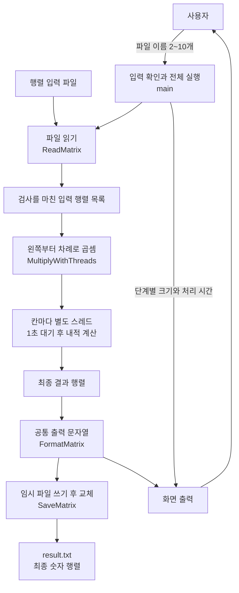
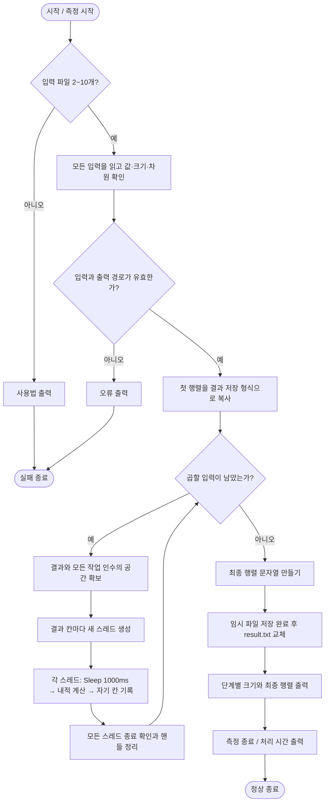
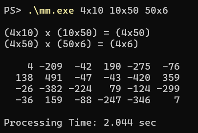
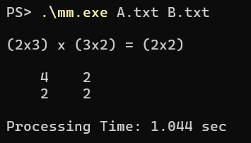
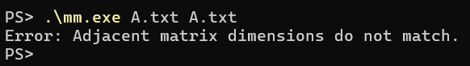

# Programming Assignment 05

## Matrix Multiplication with Thread

| 구분 | 내용 |
|---|---|
| 과목 | DCCS301 Operating System |
| 작성자 | 전남규 |
| 학번 | 2020271319 |
| 개발 언어 | C++17 |
| 개발 환경 | Windows, Visual Studio Community 2026 |
| 빌드 구성 | Release / x64 |
| 실행 파일 | `mm.exe` |

파일에 저장된 행렬을 읽어 차례로 곱하는 콘솔 프로그램입니다. 결과 행렬의 각 칸을 서로 다른 Windows 스레드가 계산하고, 최종 결과를 화면과 `result.txt`에 출력합니다. 화면에는 단계별 행렬 크기와 전체 처리 시간도 표시합니다.

## 목차

1. [프로그램 개요](#1-프로그램-개요)
2. [시스템 설명](#2-시스템-설명)
3. [테스트 결과 설명](#3-테스트-결과-설명)
4. [사용자 설명](#4-사용자-설명)
5. [자기 평가](#5-자기-평가)

## 1. 프로그램 개요

이번 과제의 목적은 Windows API로 스레드를 생성하고, 여러 작업을 동시에 진행하는 방법을 익히는 것입니다. 스레드는 한 프로그램 안에서 실행되는 작업의 흐름입니다. 행렬 곱셈에서는 결과의 한 칸을 구할 때 다른 결과 칸의 값이 필요하지 않으므로, 각 칸을 별도 스레드에 맡길 수 있습니다.

다음은 `4x10`, `10x50`, `50x6` 파일을 읽어 계산한 결과입니다. 각 파일에 적힌 숫자와 줄바꿈을 읽어 행렬 크기를 알아냅니다.

```text
(4x10) x (10x50) = (4x50)
(4x50) x (50x6) = (4x6)

    4 -209  -42  190 -275  -76
  138  491  -47  -43 -420  359
  -26 -382 -224   79 -124 -299
  -36  159  -88 -247 -346    7

Processing Time: 2.044 sec
```

첫 단계는 4×50 결과의 200칸을 계산하고, 두 번째 단계는 4×6 결과의 24칸을 계산합니다. 각 단계에서 새 스레드를 만들며, 이전 단계의 계산이 모두 끝난 다음 그 결과를 다음 행렬과 곱합니다. 위 시간은 한 번의 실행에서 측정한 값으로, 컴퓨터 상태와 실행할 때마다 달라집니다.

주요 기능과 입력 조건은 다음과 같습니다.

- 실행할 때 행렬 파일 이름을 2~10개 지정합니다.
- 입력 행렬의 행과 열은 각각 `1~100`개이며, 원소는 `-3~3` 범위의 정수입니다.
- 앞 행렬의 열 수와 다음 행렬의 행 수가 같아야 합니다.
- `A B C D`를 입력하면 `((A × B) × C) × D` 순서로 계산합니다.
- 매 단계에서 결과의 행 수 × 열 수만큼 서로 다른 작업 스레드를 생성합니다.
- 각 작업 스레드는 `Sleep(1000)`으로 1초 기다린 뒤 자기 칸을 계산합니다.
- 최종 행렬은 화면과 `result.txt`에 같은 숫자와 정렬로 출력합니다.
- 단계별 크기와 처리 시간, 구간을 나누는 빈 줄은 화면에만 표시합니다.

제공된 샘플에만 맞춘 프로그램은 아닙니다. 형식과 크기 조건이 맞으면 `A.txt`, `B.txt`처럼 다른 이름의 새 파일도 사용할 수 있습니다.

## 2. 시스템 설명

### 2.1 시스템 구성

전체 실행 순서, 행렬 저장, 큰 정수 계산, 파일 처리와 스레드 관리를 나누었습니다. `main`은 이 기능들을 순서대로 연결하며, 실패한 이유를 마지막에 출력합니다.

| 구성 요소 | 역할 |
|---|---|
| [main.cpp](project/src/main.cpp) | 명령행과 입력 조건을 확인하고, 연속 곱셈·단계 안내·결과 저장·시간 측정을 진행합니다. |
| [Matrix.h](project/src/Matrix.h) | 행·열 크기와 원소를 저장합니다. 입력 행렬과 결과 행렬이 같은 구조를 사용합니다. |
| [MatrixValue](project/src/MatrixValue.cpp) | 연속 곱셈으로 커지는 정수를 부호와 9자리 묶음으로 나누어 정확히 계산합니다. |
| [MatrixFile](project/src/MatrixFile.cpp) | 행렬 파일을 읽고, 공통 출력 문자열을 만들며, 완성된 결과 파일을 저장합니다. |
| [ThreadMultiplier](project/src/ThreadMultiplier.cpp) | 결과 칸별 스레드를 만들고, 계산 종료를 기다린 뒤 핸들을 정리합니다. |

외부 라이브러리는 추가하지 않았습니다. C++ 표준 라이브러리로 자료를 저장하고 파일을 처리하며, 스레드는 Windows API를 사용합니다. API는 운영체제가 프로그램에 제공하는 함수입니다.

### 2.2 사용한 Windows API

#### `CreateThread()`

[`CreateThread()`](https://learn.microsoft.com/en-us/windows/win32/api/processthreadsapi/nf-processthreadsapi-createthread)는 새 작업 스레드를 만듭니다. 이 프로그램은 다음과 같이 계산할 칸의 정보를 전달합니다.

```cpp
CreateThread(nullptr, kStackReserve, CalculateCell, &task,
    STACK_SIZE_PARAM_IS_A_RESERVATION, nullptr);
```

| 인수 | 설정과 이유 |
|---|---|
| `nullptr` | 기본 보안 속성을 사용합니다. |
| `kStackReserve` | 스레드의 작업용 스택 예약 공간을 64KiB로 지정합니다. |
| `CalculateCell` | 새 스레드가 실행할 함수입니다. |
| `&task` | 입력 행렬과 담당 좌표, 기록할 결과 칸의 주소를 전달합니다. |
| `STACK_SIZE_PARAM_IS_A_RESERVATION` | 두 번째 인수를 스택의 예약 크기로 사용합니다. |
| 마지막 `nullptr` | 정상 계산에는 스레드 번호를 별도로 보관할 필요가 없습니다. |

100×100 결과에는 스레드가 10,000개 필요합니다. 작업 함수에 재귀나 큰 지역 배열이 없어 스택 예약 크기를 64KiB로 정했습니다. 생성에 실패하면 `GetLastError()`로 받은 오류를 전달합니다.

#### `Sleep(1000)`

[`Sleep()`](https://learn.microsoft.com/en-us/windows/win32/api/synchapi/nf-synchapi-sleep)은 호출한 스레드를 지정한 밀리초 동안 쉬게 합니다. 과제 조건에 맞춰 모든 작업 스레드가 계산 직전에 `Sleep(1000)`을 한 번 호출합니다. 메인 스레드에서 한 번만 기다리는 것으로 대신하지 않았습니다.

대기가 끝나도 다른 작업 때문에 곧바로 실행되지 않을 수 있습니다. 따라서 각 단계가 정확히 1.000초 만에 끝난다고 보장하지는 않습니다.

#### `WaitForSingleObject()`와 `CloseHandle()`

[`WaitForSingleObject()`](https://learn.microsoft.com/en-us/windows/win32/api/synchapi/nf-synchapi-waitforsingleobject)는 작업 스레드의 종료를 기다립니다. 정상적으로 종료됐으면 [`CloseHandle()`](https://learn.microsoft.com/en-us/windows/win32/api/handleapi/nf-handleapi-closehandle)로 사용한 핸들을 닫습니다. 핸들은 Windows가 관리하는 작업을 가리키는 값입니다.

스레드를 모두 생성한 다음 기다리므로, 핸들을 하나씩 확인해도 계산 자체가 한 칸씩 순차 실행되는 것은 아닙니다. 정상 종료를 확인하고 닫은 핸들은 목록에서 빼서 다시 기다리거나 두 번 닫지 않습니다.

#### 결과 파일 저장에 사용한 API

| API | 역할 |
|---|---|
| [`GetTempFileNameW()`](https://learn.microsoft.com/en-us/windows/win32/api/fileapi/nf-fileapi-gettempfilenamew) | 결과와 같은 폴더에 이름이 겹치지 않는 임시 파일을 만듭니다. |
| [`MoveFileExW()`](https://learn.microsoft.com/en-us/windows/win32/api/winbase/nf-winbase-movefileexw) | 임시 파일에 쓰기가 끝난 다음 `result.txt`로 교체합니다. |
| [`DeleteFileW()`](https://learn.microsoft.com/en-us/windows/win32/api/fileapi/nf-fileapi-deletefilew) | 저장에 실패한 경로에서 이 실행이 만든 임시 파일을 정리합니다. |
| [`GetLastError()`](https://learn.microsoft.com/en-us/windows/win32/api/errhandlingapi/nf-errhandlingapi-getlasterror) | Windows 함수가 실패했을 때 오류 번호를 받습니다. |

함수 이름 끝의 `W`는 유니코드 문자열을 받는 버전입니다. 경로를 읽을 때도 `wmain`과 `std::filesystem::path`를 사용해 한글이나 공백이 있는 파일 이름을 처리합니다.

### 2.3 데이터 흐름도



화면과 파일에 사용할 행렬 문자열은 한 번만 만듭니다. 같은 숫자를 각각 다시 변환하지 않고 공유하므로 양쪽의 값과 정렬을 맞출 수 있습니다.

### 2.4 프로그램 순서도



스레드 생성 중 실패하면 이미 생성한 스레드가 모두 끝날 때까지 기다린 뒤 정리합니다. 계산과 저장이 성공한 경우에만 단계 안내와 최종 행렬을 화면에 출력합니다. 입력 오류가 뒤쪽 파일에 있어도 앞쪽 곱셈부터 시작하지 않도록 전체 입력을 먼저 확인합니다.

### 2.5 주요 클래스와 함수

| 클래스·함수 | 입력 | 반환값 | 역할 |
|---|---|---|---|
| `wmain` | 명령행 인수 | 종료 코드 | 파일을 읽고 곱셈·저장·출력을 진행합니다. 성공은 0, 실패는 1입니다. |
| `Matrix<Value>` | 행·열 크기 | 행렬 객체 | 크기를 확인하고 모든 칸을 0으로 준비합니다. |
| `Matrix::At` | 0부터 시작하는 행·열 번호 | 원소 참조 | 해당 칸을 읽거나 기록합니다. |
| `ReadMatrix` | 파일 경로 | `InputMatrix` | 숫자와 줄바꿈을 읽어 행렬을 만들고 입력 조건을 검사합니다. |
| `ToResultMatrix` | 첫 입력 행렬 | `ResultMatrix` | 작은 입력 정수를 큰 결과 정수 형식으로 복사합니다. |
| `MultiplyWithThreads` | 왼쪽 결과, 오른쪽 입력 | 새 결과 행렬 | 결과 칸 수만큼 새 스레드를 만들어 곱셈 한 단계를 끝냅니다. |
| `CalculateCell` | `CellTask`의 주소 | 작업 종료 값 0 | 1초 대기 후 담당 칸의 내적을 계산합니다. |
| `WorkerThreads::Start` | 담당 칸의 정보 | 없음 | `CreateThread()`를 호출하고 받은 핸들을 보관합니다. |
| `WorkerThreads::Wait` | 없음 | 없음 | 생성한 작업의 종료를 확인하고 핸들을 닫습니다. |
| `WorkerThreads` 소멸자 | 없음 | 없음 | 예외 경로에서 남은 스레드와 핸들을 정리합니다. |
| `MatrixValue::AddProduct` | 큰 정수, -3~3의 입력값 | 없음 | 곱한 값을 현재 합계에 정확히 더합니다. |
| `MatrixValue::ToString` | 없음 | 십진수 문자열 | 큰 결과값을 자르지 않고 출력할 수 있게 바꿉니다. |
| `FormatMatrix` | 최종 결과 행렬 | 출력 문자열 | 열을 정렬한 숫자 행렬을 만듭니다. |
| `SaveMatrix` | 출력 문자열, 결과 경로 | 없음 | 파일 쓰기 완료를 확인하고 결과 파일을 교체합니다. |
| `TemporaryResult` | 결과 경로 | 임시 파일 관리 객체 | 임시 파일의 생성·교체·실패 시 정리를 담당합니다. |

주요 자료형은 다음과 같습니다.

| 자료형 | 보관하는 정보 |
|---|---|
| `InputMatrix` | 원소가 `int`인 입력 행렬. 값은 -3~3입니다. |
| `ResultMatrix` | 원소가 `MatrixValue`인 중간 결과와 최종 결과 행렬입니다. |
| `CellTask` | 두 입력의 주소, 기록할 칸의 주소, 담당 행·열 번호입니다. |
| `WorkerThreads` | 이 곱셈 단계에서 생성한 스레드의 핸들 목록입니다. |
| `MatrixValue` | 부호와 9자리 정수 묶음 세 개입니다. |

### 2.6 행렬 곱셈과 스레드 수

왼쪽 행렬이 m×k이고 오른쪽 행렬이 k×n이면 결과는 m×n입니다. 결과의 i행 j열은 다음과 같이 구합니다. 코드에서는 행과 열 번호가 0부터 시작합니다.

```text
C[i][j] = A[i][0] × B[0][j]
        + A[i][1] × B[1][j]
        + ...
        + A[i][k-1] × B[k-1][j]
```

한 칸의 계산에는 왼쪽 한 행과 오른쪽 한 열만 필요합니다. 작업 함수는 합계를 자기 안에 보관하다가 완성된 값을 담당 칸에 기록합니다.

| 곱셈 | 결과 | 새로 생성하는 스레드 |
|---|---|---:|
| 2×3 × 3×2 | 2×2 | 4개 |
| 4×10 × 10×50 | 4×50 | 200개 |
| 4×50 × 50×6 | 4×6 | 24개 |
| 100×100 × 100×100 | 100×100 | 10,000개 |

결과 칸마다 별도 스레드를 쓰는 것이 과제 조건이므로, 몇 개의 스레드가 여러 칸을 나누어 계산하도록 바꾸지 않았습니다.

### 2.7 연속 곱셈과 대기 순서

행렬 세 개의 입력이 `4x10 10x50 50x6`이면 먼저 앞의 두 행렬을 곱해 4×50 결과를 만듭니다. 이 단계의 스레드 200개가 모두 끝난 뒤, 그 결과와 세 번째 행렬을 곱하도록 스레드 24개를 새로 만듭니다.

같은 단계 안에서는 스레드들의 1초 대기가 겹쳐 진행됩니다. 예를 들어 결과가 2×2일 때 칸마다 1초 대기하는 조건을 순차적으로 적용하면 대기 시간이 약 4초입니다. 네 스레드가 각각 기다리도록 하면 대기가 겹치므로 한 단계의 예상 시간은 약 1초에 생성·계산·정리 시간을 더한 값입니다.

행렬이 p개면 곱셈 단계는 p-1개입니다. 실제 시간에는 스레드 생성과 Windows의 실행 순서 조정, 파일 읽기·쓰기와 화면 출력 비용도 포함됩니다. 스레드 수만큼 항상 빨라진다고 해석하지 않았습니다.

### 2.8 작업 정보의 수명과 동시 기록

여러 스레드에 배열의 주소를 전달한 뒤 배열이 이동하거나 사라지면 잘못된 곳을 읽을 수 있습니다. 이를 피하려고 다음과 같이 구성했습니다.

- 결과 행렬과 `CellTask` 전체 공간을 스레드 생성 전에 확보합니다.
- 스레드가 실행 중인 동안 이 공간의 크기를 바꾸지 않습니다.
- 입력 행렬은 읽기 전용으로 공유하고, 각 스레드는 서로 다른 결과 칸에만 기록합니다.
- 스레드 관리 객체를 나중에 선언해 예외가 발생해도 이 객체가 먼저 남은 작업을 기다리게 합니다.
- 모든 작업이 끝나기 전에는 결과를 반환하거나 다음 단계로 넘어가지 않습니다.

같은 칸을 동시에 수정하는 스레드가 없으므로 계산에 잠금은 사용하지 않았습니다. 잠금을 생략한 대신, 기록 위치가 겹치지 않는 구조와 종료 대기로 작업 순서를 보장했습니다.

### 2.9 큰 정수의 처리

입력값이 작아도 행렬을 여러 번 곱하면 결과는 크게 증가합니다. 모든 차원이 100이고 입력값의 절댓값이 3이면, p개를 곱한 결과 한 칸의 절댓값은 최대 `3^p × 100^(p-1)`입니다.

입력 10개의 최대치는 다음과 같습니다.

```text
3^10 × 100^9 = 59049000000000000000000
```

이 값은 64비트 정수에 들어가지 않습니다. `MatrixValue`는 부호와 9자리 묶음 세 개로 값을 저장해 최대 27자리를 표현합니다. 양수와 음수의 곱을 구분하고, 같은 부호는 더하며 다른 부호는 절댓값이 큰 쪽에서 작은 쪽을 뺍니다. 값이 상쇄되면 부호도 0으로 맞춥니다.

큰 정수끼리의 일반 곱셈까지 구현하지는 않았습니다. 왼쪽부터 계산하면 매 단계의 오른쪽 행렬은 원래 입력이므로 값이 항상 -3~3입니다. 따라서 큰 정수에 이 작은 값을 곱해 합계에 더하는 연산으로 충분합니다. 이번 과제의 범위와 계산 순서에 맞춘 자료형이며, 자릿수 제한 없는 범용 정수형은 아닙니다.

### 2.10 파일 형식, 결과 저장과 시간 측정

입력 파일에는 행·열 크기를 따로 적지 않습니다. 공백으로 열을, 줄바꿈으로 행을 구분하며 모든 행의 원소 수가 같은지 확인합니다. 빈 줄은 행으로 세지 않고, 탭·마지막 줄바꿈 생략·파일 시작의 UTF-8 BOM도 처리합니다. BOM은 UTF-8 파일 앞에 붙을 수 있는 문자 형식 표시입니다.

```text
1 2 3
1 0 1
```

위 파일은 2×3 행렬입니다. 이름이 `A.txt`여도 같은 크기로 읽습니다. `1.0`이나 `1abc`에서 앞의 1만 읽고 넘어가지 않도록, 항목 전체가 정수인지 검사합니다.

최종 결과는 가장 긴 숫자보다 한 칸 넓게 열을 맞춥니다. 화면에는 단계별 크기와 처리 시간도 보이지만, 파일에는 숫자 행렬만 저장합니다. 결과 파일을 임시 파일에 끝까지 쓴 다음 교체하므로, 저장 실패 때문에 기존 결과를 먼저 비우지 않습니다. 입력과 출력이 실제로 같은 파일인지도 확인해 입력을 덮어쓰지 않게 했습니다.

시간은 `std::chrono::steady_clock`으로 측정합니다. 프로그램 진입 직후부터 입력 읽기, 스레드 생성·대기·계산·정리, 결과 저장과 행렬 화면 출력 완료까지 포함합니다. 달력 시각을 바꾸어도 측정용 시계가 뒤로 흐르지 않는 방식을 사용했습니다. 운영체제가 실행파일을 적재하는 시간과 마지막 시간 안내문 자체의 출력 시간은 포함하지 않습니다.

### 2.11 오류 처리와 효율성

| 상황 | 처리 방법 |
|---|---|
| 파일 개수가 2개 미만 또는 10개 초과 | 사용법을 표시하고 실패 종료합니다. |
| 파일 없음·빈 파일·잘못된 정수 | 이유를 알리고 계산을 시작하지 않습니다. |
| 원소 범위·행·열 제한 위반 | 입력을 거부하고 기존 결과 파일을 유지합니다. |
| 이웃 행렬의 크기가 맞지 않음 | 전체 입력 검사에서 중단합니다. |
| 결과 파일과 입력 파일이 같음 | 이름이 달라도 같은 실제 파일이면 거부합니다. |
| 스레드 생성 실패 | 이미 시작한 작업이 끝날 때까지 기다린 뒤 핸들을 정리합니다. |
| 결과 쓰기·교체 실패 | 오류를 알리고 임시 파일을 정리합니다. |
| 화면 출력 실패 | 성공으로 처리하지 않고 실패 종료합니다. |

스레드 정리 중에도 종료 확인이 계속 실패하면 살아 있는 작업이 참조하는 메모리를 해제하고 실행을 이어갈 수 없습니다. 이 경우에는 프로그램을 종료하도록 했습니다. 모든 운영체제 오류에서 복구를 보장하는 구조는 아닙니다.

| 작업 | 작업량·공간 | 선택한 이유 |
|---|---|---|
| 한 단계의 내적 계산 | 전체 O(m×k×n) | 결과의 m×n칸마다 k개 곱을 더합니다. |
| 스레드 생성·종료 확인 | m×n개 작업 | 과제에서 정한 칸별 스레드 조건을 따릅니다. |
| 결과와 작업 정보 | O(m×n) 공간 | 모든 결과 칸과 스레드 인수를 안정된 위치에 둡니다. |
| 큰 정수 연산 | 정해진 세 묶음 | 입력 제한에서 필요한 자릿수만 보관합니다. |
| 최종 문자열 생성 | 결과 칸 수와 출력 문자 수에 비례 | 각 값을 한 번 변환해 화면과 파일이 공유합니다. |

`O(m×k×n)`은 전체 산술 연산량입니다. 실행 시간을 살펴볼 때는 1초 대기와 많은 스레드의 생성 비용도 함께 고려해야 합니다. 곱셈은 왼쪽부터 진행하도록 정해 실행 순서와 큰 정수 처리 구조를 단순하게 유지했습니다.

### 2.12 프로젝트 구조

```text
assignment-05/
├─ README.md
├─ images/
│  ├─ matrix-sample.png
│  ├─ matrix-small.png
│  └─ matrix-error.png
├─ test-results/
│  ├─ release.json
│  ├─ debug.json
│  ├─ native-release.json
│  └─ matrix-*.txt
└─ project/
   ├─ mm.sln
   ├─ mm.vcxproj
   ├─ mm.vcxproj.filters
   ├─ 4x10, 10x50, 50x6
   ├─ src/
   │  ├─ main.cpp
   │  ├─ Matrix.h
   │  ├─ MatrixValue.h / MatrixValue.cpp
   │  ├─ MatrixFile.h / MatrixFile.cpp
   │  └─ ThreadMultiplier.h / ThreadMultiplier.cpp
   ├─ test-data/
   │  ├─ matrix_1/
   │  ├─ matrix_2/
   │  └─ matrix_3/
   └─ tests/
      ├─ verify.py
      ├─ run_native.py
      ├─ thread_contract.cpp
      └─ value_arithmetic.cpp
```

[전체 소스 코드 보기](project/src)

프로젝트와 입력 경로는 상대경로로 구성했습니다. 테스트 입력과 예상 정답을 함께 보관하고, 정답 파일은 실행 결과와 혼동하지 않도록 `expected.txt`로 구분했습니다. 저장소에는 생성된 실행파일, 개인 IDE 설정과 빌드 임시 파일을 포함하지 않습니다.

## 3. 테스트 결과 설명

### 3.1 테스트 환경

| 항목 | 환경 |
|---|---|
| 검증일 | 2026-10-29 |
| 운영체제 | Windows / x64 |
| IDE | Visual Studio Community 2026 |
| 도구 집합 | MSVC v145 |
| 언어 표준 | C++17 |
| 검증 구성 | Debug / x64, Release / x64 |
| Release 런타임 | C++ 실행 지원 기능을 실행파일에 포함하는 `/MT` 방식 |
| 행렬 정답 비교 | Python 정수로 독립 계산한 값 |

개발과 테스트에는 Visual Studio Community 2026을 사용했습니다. Debug와 Release에서 각각 빌드하고 같은 입력을 넣어 결과를 비교했습니다. 프로젝트는 Visual Studio 2022에서 v143, 2026에서 v145를 선택하도록 구성했습니다.

### 3.2 빌드와 실제 출력 테스트

| 테스트 | 실제 결과 | 판정 |
|---|---|:---:|
| Release/x64 빌드 | 경고 없이 성공 | 통과 |
| Debug/x64 빌드 | 경고 없이 성공 | 통과 |
| Release 실행 검사 40개 | 정상·오류 입력과 최대 범위 결과 일치 | 통과 |
| Debug 실행 검사 40개 | 같은 검사 모두 통과 | 통과 |
| 단계별 행렬 크기 | 입력 개수에 맞는 단계 수와 각 행·열 크기 표시 | 통과 |
| 화면과 결과 파일 | 모든 원소가 독립 정답과 같고 파일에 안내문이 섞이지 않음 | 통과 |
| 새 이름·새 크기의 입력 | 고정 난수로 생성한 직사각형 행렬도 정상 계산 | 통과 |
| 한글·공백 파일 이름 | 정상적으로 읽고 계산 | 통과 |
| 10개 입력 | 9단계 계산과 대기 시간 하한 확인 | 통과 |

세 테스트 세트의 예상 정답과 Python으로 계산한 값이 일치하는지 확인한 뒤, 프로그램의 화면·파일 출력과 비교했습니다.

| 샘플 | 입력 순서 | 결과 크기 | Release 처리 시간 |
|---|---|---|---:|
| matrix_1 | 20×40 → 40×60 → 60×80 → 80×100 → 100×100 | 20×100 | 4.473초 |
| matrix_2 | 4×10 → 10×50 → 50×6 | 4×6 | 2.050초 |
| matrix_3 | 100×100 → 100×90 → 90×80 → 80×100 | 100×100 | 4.100초 |

처리 시간은 실행 시점의 부하에 따라 달라집니다. 테스트에서는 결과값이 정답과 일치하는지, 각 단계에서 필요한 대기가 포함됐는지를 확인했습니다.

### 3.3 최대 범위, 스레드와 오류 처리 테스트

100×100 행렬 10개를 곱하는 검사는 한 실행에 총 90,000개의 작업 스레드를 생성합니다. 부호와 상쇄도 함께 확인했습니다.

| 입력·상황 | 확인한 결과 | Release 시간 | 판정 |
|---|---|---:|:---:|
| 모든 입력 원소가 3 | 모든 칸이 `59049000000000000000000` | 13.603초 | 통과 |
| 첫 행렬만 -3, 이후 모두 3 | 모든 칸이 `-59049000000000000000000` | 13.474초 | 통과 |
| 마지막 행렬에 양수·음수를 섞음 | 큰 음수·0·큰 양수가 함께 나오는 결과와 독립 정답 일치 | 13.678초 | 통과 |

Windows 스레드 검사에서는 생성·대기·정리 횟수를 확인했습니다. 평소 실행에서 확인하기 어려운 오류 처리는 함수가 한 번 실패하도록 설정해, 시작한 작업과 핸들이 끝까지 정리되는지 검사했습니다.

| 검사 | 확인한 결과 | 판정 |
|---|---|:---:|
| 결과 2×3 | 서로 다른 스레드 6개, `Sleep(1000)` 6회, 정확한 결과 | 통과 |
| 세 개 생성 후 다음 생성 실패 | 시작한 세 개가 모두 끝나고 핸들도 정리됨 | 통과 |
| 첫 생성 실패 | 남은 작업이나 핸들 없음 | 통과 |
| 대기 함수 1회 실패 응답 | 예외 경로에서 남은 작업을 기다리고 정리 | 통과 |
| 핸들 닫기 1회 실패 응답 | 남은 핸들을 정리하고 오류 전달 | 통과 |
| 결과 100×100 | 생성·1초 대기·종료 대기·핸들 정리 각각 10,000회 | 통과 |

큰 정수는 Python 정답과 **8,480회** 별도로 비교했습니다. 같은 변수에 더하기, 반대 부호, 9자리 경계의 올림·빌림과 상쇄를 포함했습니다. 이 별도 네이티브 검사는 Release 구성으로 수행했습니다.

| 잘못된 입력·파일 상태 | 확인한 결과 | 판정 |
|---|---|:---:|
| 파일 0개·1개·11개 | 사용법 표시 후 실패 종료 | 통과 |
| 없는 파일·빈 파일·들쭉날쭉한 행 | 잘못된 입력을 거부 | 통과 |
| 범위 밖 값·소수·지나치게 큰 정수 | 정상 정수로 잘못 받아들이지 않음 | 통과 |
| 101행·101열 | 크기 제한 위반으로 거부 | 통과 |
| 뒤쪽 입력의 곱셈 차원 불일치 | 계산과 결과 교체 전에 중단 | 통과 |
| 결과 파일을 입력으로 지정 | 기존 입력 보존 | 통과 |
| 이름이 다른 같은 파일인 하드 링크 | 같은 실제 파일로 검출 | 통과 |
| 결과 경로가 폴더·읽기 전용·다른 작업에 열려 있음 | 실패를 알리고 이전 내용 보존, 임시 파일 정리 | 통과 |

검사 요약은 [Release 결과](test-results/release.json), [Debug 결과](test-results/debug.json), [스레드·큰 정수 검사](test-results/native-release.json)에 보관했습니다. 다시 실행할 수 있도록 [검사 코드](project/tests)도 함께 두었습니다.

### 3.4 실행 결과

#### 세 행렬의 연속 곱셈

4×10과 10×50의 곱에서 4×50이 만들어지고, 여기에 50×6을 곱해 4×6 결과가 나옵니다. 단계 안내와 행렬, 처리 시간 사이의 빈 줄도 확인할 수 있습니다.



위 실행에서는 두 단계의 곱셈을 마치는 데 2.044초가 걸렸습니다.

#### 작은 행렬의 곱셈

2×3과 3×2를 곱하면 결과가 2×2이므로 스레드는 네 개입니다. 결과는 첫 행이 `4 2`, 둘째 행이 `2 2`입니다.



한 단계의 곱셈을 마치는 데 1.044초가 걸렸습니다.

#### 곱셈할 수 없는 입력

2×3 행렬인 `A.txt`를 두 번 지정하면 왼쪽의 열 수 3과 오른쪽의 행 수 2가 맞지 않습니다. 이 경우 오류를 표시하고 계산을 중단합니다.



## 4. 사용자 설명

### 4.1 준비 환경

- Windows와 C++ 데스크톱 개발 기능이 설치된 Visual Studio
- Visual Studio Community 2022의 v143 또는 Visual Studio Community 2026의 v145
- 설치된 Windows SDK

프로젝트는 Visual Studio 2022에서 v143, 2026에서 v145를 선택하도록 설정했습니다. Windows SDK는 설치된 10.0 계열을 사용합니다. 실행과 빌드에는 Python이나 추가 패키지가 필요하지 않습니다.

### 4.2 소스 내려받기

1. 저장소 상단의 `Code` 버튼을 누릅니다.
2. `Download ZIP`을 선택하고 압축을 풉니다.
3. `assignments\assignment-05\project` 폴더로 이동합니다.

이 폴더에는 바로 시험할 수 있는 `4x10`, `10x50`, `50x6` 입력 파일이 있습니다.

### 4.3 Visual Studio에서 컴파일

1. `mm.sln`을 엽니다.
2. 솔루션 구성은 `Release`, 플랫폼은 `x64`를 선택합니다.
3. `빌드 > 솔루션 빌드` 또는 `Ctrl+Shift+B`를 누릅니다.
4. 빌드가 끝나면 다음 위치에 실행파일이 만들어집니다.

```text
project\bin\x64\Release\mm.exe
```

IDE에서 실행하려면 프로젝트 속성의 `디버깅 > 명령 인수`에 `4x10 10x50 50x6`, `작업 디렉터리`에 `$(ProjectDir)`를 지정한 뒤 `Ctrl+F5`를 누릅니다. 입력 파일 이름을 지정하지 않으면 사용법을 표시하고 종료합니다.

### 4.4 PowerShell에서 실행

`project` 폴더에서 PowerShell을 열고 실행합니다.

```powershell
.\bin\x64\Release\mm.exe 4x10 10x50 50x6
```

행렬 세트의 위치를 직접 지정할 수도 있습니다.

```powershell
.\bin\x64\Release\mm.exe test-data\matrix_1\20x40 test-data\matrix_1\40x60 test-data\matrix_1\60x80 test-data\matrix_1\80x100 test-data\matrix_1\100x100
```

PowerShell에서는 현재 폴더의 프로그램 앞에 `.\`를 붙입니다. 파일이 다른 폴더에 있으면 경로를 적고, 경로에 공백이 있으면 큰따옴표로 묶습니다.

### 4.5 명령 프롬프트에서 실행

`project` 폴더에서 명령 프롬프트를 열고 실행합니다.

```bat
bin\x64\Release\mm.exe 4x10 10x50 50x6
```

실행파일과 입력 파일들을 같은 폴더에 두었다면 다음과 같이 파일 이름만 적을 수 있습니다.

```bat
mm.exe 4x10 10x50 50x6
```

`4x10`은 크기를 지정하는 명령이 아니라 파일 이름입니다. 실행 위치에서 이 파일을 찾을 수 있어야 합니다.

### 4.6 새 입력 만들기와 결과 확인

다음 두 파일을 `project` 폴더에 저장하면 새로운 입력으로 계산할 수 있습니다.

`A.txt`

```text
1 2 3
1 0 1
```

`B.txt`

```text
1 2
0 0
1 0
```

```powershell
.\bin\x64\Release\mm.exe A.txt B.txt
```

결과는 `4 2`, `2 2`의 2×2 행렬입니다. 화면에는 `(2x3) x (3x2) = (2x2)`와 처리 시간이 함께 나오고, **실행한 현재 폴더**의 `result.txt`에는 최종 행렬만 저장됩니다. 실행파일이 있는 폴더에 항상 저장되는 것은 아닙니다.

한 번 계산한 뒤 자동 종료합니다. 기존 `result.txt`는 새 계산과 저장이 성공하면 교체됩니다. 원소가 -3~3이라는 조건은 입력에 적용되므로 결과값은 이 범위를 넘어갈 수 있습니다.

### 4.7 문제 해결과 검사 다시 실행하기

- 창이 바로 닫히면 터미널을 먼저 열고 파일 이름을 지정해 실행합니다.
- 실행파일을 찾지 못하면 현재 폴더와 빌드 결과 위치를 확인합니다.
- 입력 파일을 찾지 못하면 파일 이름, 확장자와 경로를 확인합니다.
- 차원 오류가 나오면 앞 행렬의 열 수와 다음 행렬의 행 수를 확인합니다.
- 결과 파일을 저장할 수 없으면 읽기 전용 여부나 다른 프로그램이 열고 있는지 확인합니다.
- 스레드 생성 오류가 나오면 동시에 실행하는 다른 작업과 메모리 사용 상태를 확인합니다. 프로그램은 시작한 작업을 정리한 뒤 실패를 알립니다.
- 빌드 도구나 SDK가 없으면 Visual Studio Installer의 C++ 데스크톱 개발 기능과 프로젝트의 SDK 선택을 확인합니다.

자동 검사에는 Python 3가 필요합니다. 추가 Python 패키지는 사용하지 않으며, `project` 폴더에서 다음과 같이 실행합니다.

```bat
python tests/verify.py --stress
python tests/verify.py --exe bin/x64/Debug/mm.exe --stress
python tests/run_native.py
```

앞의 두 검사는 각각 해당 구성으로 먼저 빌드한 뒤 실행합니다. 마지막 검사는 설치된 Visual Studio를 찾아 별도 검사 프로그램을 빌드합니다. 많은 스레드를 생성하는 검사는 시간이 걸리며 결과는 `project/tmp` 안에 따로 저장됩니다.

## 5. 자기 평가

### 독창성: 90 / 100

이번 과제에서는 행렬 곱셈의 결과 칸들이 서로 독립적이라는 점을 스레드 구조와 연결했습니다. 한 행렬을 여러 부분으로 나누는 것뿐 아니라, 각 스레드가 읽을 정보와 쓸 위치를 명확히 정하고 모든 작업이 끝나는 시점을 확인하는 것이 중요하다고 생각했습니다. 입력은 함께 읽되 결과는 자기 칸에만 쓰도록 구성해, 계산 중 같은 값을 여러 스레드가 수정하지 않게 했습니다.

특히 스레드에 주소를 전달한 뒤 원래 자료가 먼저 사라지지 않아야 한다는 점을 고려했습니다. 결과와 작업 정보의 공간을 먼저 확보하고, 예외가 발생하더라도 스레드 관리 객체가 남은 작업을 기다린 뒤 메모리가 정리되도록 순서를 맞췄습니다. 정상 실행에서 답이 나오는지만 보는 대신 생성·대기·정리의 실패 경로도 별도로 확인했습니다.

입력값이 -3~3이라도 행렬 10개를 연속으로 곱하면 일반적인 64비트 정수의 범위를 넘을 수 있습니다. 이 제한을 계산해 보고, 부호와 9자리 묶음 세 개로 결과를 저장했습니다. 왼쪽부터 곱하는 구조에서는 오른쪽 값이 항상 작은 입력 정수라는 점을 이용해 필요한 연산만 구현했습니다. 최댓값뿐 아니라 음수와 값이 상쇄되는 경우도 독립 정답과 대조했습니다.

파일 읽기, 큰 정수 계산, 스레드 관리와 전체 실행 흐름을 나누고, 주석에는 각 부분의 역할과 설계 이유를 적었습니다. 사용자가 실제로 실행할 때 계산 과정을 확인할 수 있도록 단계별 크기를 표시했고, 화면과 파일에 같은 행렬 문자열을 사용했습니다. 결과 저장 도중 문제가 생겼을 때 이전 파일이 먼저 지워지지 않도록 임시 파일을 사용하는 처리도 추가했습니다.

기본적인 행렬 곱셈 공식에 칸별 스레드를 적용한 프로그램이므로 알고리즘 자체의 독창성에는 한계가 있습니다. 큰 입력에서는 스레드를 많이 생성하는 비용도 남아 있습니다. 이러한 한계를 반영하되, 계산 구조와 정수 범위 처리, 오류 정리, 반복해서 실행할 수 있는 검사를 함께 갖춘 점을 근거로 90점으로 평가했습니다.
