# Programming Assignment 06

## Process Scheduling — Preemptive SJF

| 구분 | 내용 |
|---|---|
| 과목 | DCCS301 Operating System |
| 작성자 | 전남규 |
| 학번 | 2020271319 |
| 개발 언어 | C++17 |
| 개발 환경 | Windows, Visual Studio Community 2026 |
| 빌드 구성 | Release / x64 |
| 실행 파일 | `sjf.exe` |

파일에 저장된 프로세스의 도착 시각, CPU burst time과 I/O burst time을 읽어 단일 CPU에서 Preemptive SJF 스케줄링을 수행하는 콘솔 프로그램입니다. Ready Queue에 있는 프로세스 중 CPU를 할당할 프로세스를 선택하고, 프로세스별 waiting time과 평균 waiting time을 화면에 출력합니다.

## 목차

1. [프로그램 개요](#1-프로그램-개요)
2. [시스템 설명](#2-시스템-설명)
3. [테스트 결과 설명](#3-테스트-결과-설명)
4. [사용자 설명](#4-사용자-설명)
5. [자기 평가](#5-자기-평가)

## 1. 프로그램 개요

이번 과제의 목적은 프로세스 스케줄링 알고리즘의 동작과 구현 방법을 이해하는 것입니다. 보고서에서는 다음 강의 용어를 사용합니다.

| 용어 | 의미 |
|---|---|
| Ready Queue | CPU를 할당받기 위해 기다리는 프로세스들의 목록입니다. |
| CPU burst time | 하나의 CPU burst에서 프로세스가 CPU를 사용해야 하는 시간입니다. |
| I/O burst time | 하나의 I/O burst에 걸리는 시간입니다. |
| waiting time | 프로세스가 Ready Queue에서 CPU 할당을 기다린 시간의 합계입니다. |
| Preemptive | 실행 중인 프로세스의 CPU를 회수해 다른 프로세스에 할당할 수 있는 방식입니다. |

SJF는 Ready Queue에 있는 프로세스 중 **다음 CPU burst time**이 가장 짧은 프로세스를 선택합니다. **Preemptive SJF에서는 New에서 도착하거나 I/O를 마친 프로세스의 다음 CPU burst time이 현재 실행 중인 프로세스의 남은 CPU burst time보다 짧으면 CPU를 회수합니다.** 이후 Ready Queue에서 가장 짧은 프로세스를 실행합니다. CPU를 회수당한 프로세스는 중단된 CPU burst의 남은 시간으로 비교하며, 같은 CPU burst를 이어서 실행합니다. 이 방식은 SRTF(Shortest-Remaining-Time-First)라고도 부릅니다.

이 프로그램의 실행 대상은 입력 파일에 적힌 가상의 프로세스입니다. 도착, CPU 실행, 입출력과 종료를 가상 시간에서 재현합니다. 실제 Windows 프로세스를 생성하거나 Windows의 CPU 할당 정책을 바꾸는 프로그램은 아닙니다.

다음은 `input1.txt`를 실행했을 때 입력 목록 뒤에 표시되는 결과입니다.

```text
Process : Waiting Time
------------------------------
P00     :   6
P01     :  21
P02     :   7
P03     :   0
P04     :   2
------------------------------
Average Waiting Time  =  7.20
```

주요 기능과 과제 조건은 다음과 같습니다.

- 실행할 때 입력 파일 하나를 명령행 인자로 지정합니다.
- 각 줄에는 프로세스 이름, 도착 시각과 CPU burst time·I/O burst time의 순서를 적습니다.
- CPU burst와 I/O burst가 번갈아 나오며, 처음과 마지막은 CPU burst입니다.
- CPU는 하나이므로 같은 시간에 한 프로세스만 실행합니다.
- 각 프로세스의 I/O burst는 서로 독립적으로 병렬 진행합니다.
- New에서 도착하거나 I/O를 마친 프로세스의 다음 CPU burst time이 실행 중인 프로세스의 남은 CPU burst time보다 짧으면 CPU를 회수하고 가장 짧은 프로세스를 즉시 실행합니다.
- 같은 시각의 Ready Queue 진입은 새 도착 → I/O 완료 → CPU를 회수당한 프로세스 순서입니다. CPU 선택은 CPU burst time을 먼저 비교하며, 비교 값이 같을 때 진입 순서를 따릅니다.
- 프로세스별 waiting time과 프로세스 수로 나눈 평균 waiting time을 출력합니다.
- 전체 출력 앞뒤에 빈 줄을 하나씩 두고, 평균은 소수점 둘째 자리까지 표시합니다.

프로세스 이름이나 개수, 파일 이름에 따라 정답을 선택하지 않습니다. 제공된 네 입력 외에도 같은 형식의 새 파일을 읽고 스케줄링 결과를 계산합니다.

## 2. 시스템 설명

### 2.1 시스템 구성

입력 읽기, 스케줄링과 화면 출력을 나누었습니다. 프로그램의 시작 함수인 `wmain`에서 입력 파일 이름을 받아 파일 읽기 → 스케줄링 → 출력 순서로 실행하도록 구성했습니다. 오류가 발생하면 같은 함수에서 이유를 출력합니다. `wmain`은 Windows에서 한글 등을 포함한 명령행 인자를 받는 `main`의 확장형입니다.

| 구성 요소 | 역할 |
|---|---|
| [main.cpp](project/src/main.cpp) | 인수 개수를 확인하고 파일 읽기·계산·출력을 연결합니다. |
| [ProcessInfo.h](project/src/ProcessInfo.h) | 프로세스 이름과 도착 시각, CPU burst time·I/O burst time의 목록을 저장합니다. |
| [ProcessFile](project/src/ProcessFile.cpp) | 파일을 줄 단위로 읽고 항목 이름·시간 값과 CPU burst·I/O burst의 순서를 확인합니다. |
| [SjfScheduler](project/src/SjfScheduler.cpp) | Ready Queue와 I/O 완료 시각을 관리하고, CPU 할당·회수·종료와 waiting time을 계산합니다. |
| [SchedulePrinter](project/src/SchedulePrinter.cpp) | 입력 목록, 프로세스별 waiting time과 평균을 예제 형식으로 출력합니다. |

입력 정보는 계산 중 바꾸지 않습니다. 스케줄러가 남은 CPU burst time, 현재 CPU burst의 위치와 누적 waiting time을 별도로 관리합니다. 외부 라이브러리는 추가하지 않았습니다.

### 2.2 사용한 C++ 기능

파일 처리, 자료 저장, 정렬과 화면 출력에는 C++ 표준 라이브러리를 사용했습니다. 프로그램의 시작 함수로는 Visual Studio의 C++ 컴파일러인 MSVC가 제공하는 `wmain`을 선택했습니다.

`wmain`의 `w`는 wide character를 뜻하며, 한글 등 여러 언어의 문자를 전달받는 데 사용하는 문자 형식입니다. 일반적인 `main`은 `char* argv[]`로 명령행 문자열을 받고, `wmain`은 `wchar_t* argv[]`로 받습니다. 입력 파일 경로를 이 문자 형식으로 받아 `std::filesystem::path`에 전달하도록 구현했습니다. 파일 이름이 `main.cpp`여도 그 안의 시작 함수 이름은 `wmain`일 수 있습니다. `wmain`은 표준 C++ 기능이 아닌 Microsoft 확장 기능입니다. [Microsoft 공식 설명](https://learn.microsoft.com/en-us/cpp/cpp/main-function-command-line-args)

| 기능 | 사용한 이유 |
|---|---|
| `wmain` | 프로그램 시작 함수로, 명령행 인자를 `wchar_t* argv[]` 형태로 받습니다. |
| `std::filesystem::path` | 전달받은 입력 파일 경로를 보관하고 파일을 여는 데 사용합니다. |
| `std::ifstream`, `std::getline` | 한 줄을 한 프로세스로 읽습니다. |
| `std::istringstream` | 공백과 탭으로 항목을 나눕니다. |
| `std::from_chars` | 시간 항목 전체가 표현 가능한 정수인지 확인합니다. |
| `std::vector` | 프로세스 정보와 Ready Queue, I/O 진행 목록을 저장합니다. |
| `std::stable_sort` | 도착 시각이 같으면 입력 파일의 줄 순서를 유지합니다. |
| `std::min_element` | 다음 CPU burst time이 가장 짧은 첫 항목을 고릅니다. 중단된 CPU burst는 남은 시간으로 비교합니다. |
| `std::optional` | CPU가 비어 있거나 다음 사건 시각이 아직 없는 상태를 표현합니다. |
| `std::ostringstream`, 출력 서식 | 출력 내용을 완성하고 waiting time의 열과 평균의 소수 자릿수를 맞춥니다. |

시간에는 부호 있는 64비트 정수인 `SimulationTime`을 사용합니다. 시간 덧셈이 이 범위를 넘으면 음수 등으로 바뀌어 잘못 계산되지 않도록 중단합니다.

### 2.3 데이터 흐름도

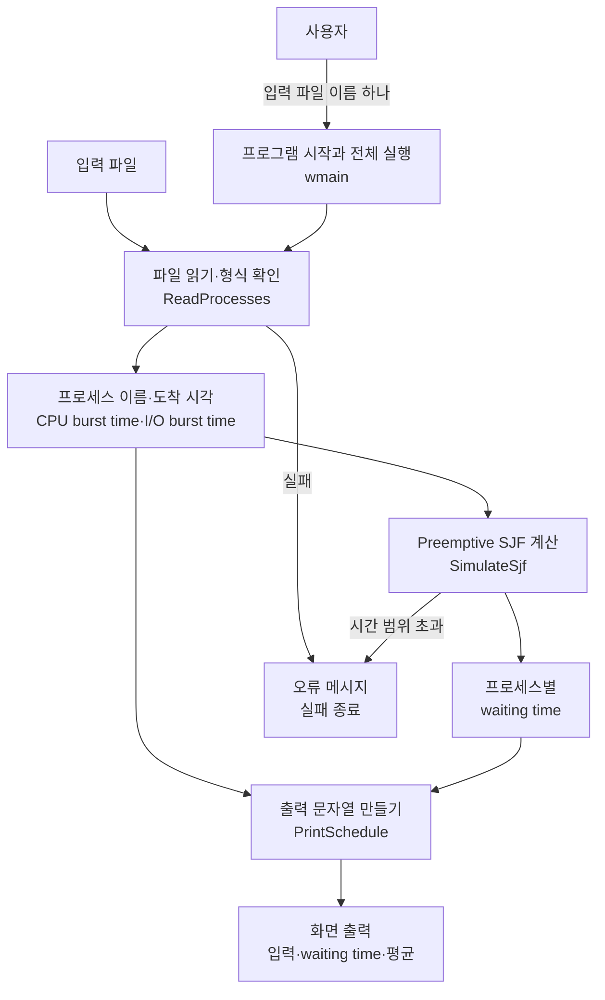

### 2.4 프로그램 순서도

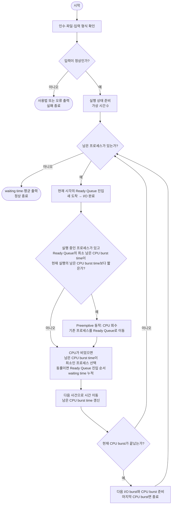

순서도의 남은 CPU burst time은 아직 실행하지 않은 CPU burst에서는 다음 CPU burst time 전체이고, 중단된 CPU burst에서는 실행한 시간을 제외한 나머지입니다. 자세한 비교 기준은 2.7절에 정리했습니다.

CPU burst 종료와 다른 사건이 겹쳐도, 현재 CPU burst를 마친 뒤 같은 시각의 새 도착과 I/O 완료를 모아 다음 프로세스를 선택합니다. 실행할 프로세스가 없으면 다음 도착 또는 I/O 완료 시각으로 이동합니다.

### 2.5 주요 클래스와 함수

| 자료형·함수 | 입력 | 반환값 | 역할 |
|---|---|---|---|
| `wmain` | 명령행 인수 | 종료 코드 | 프로그램을 시작해 파일 읽기·계산·출력을 연결합니다. 성공은 0, 오류는 1입니다. |
| `ProcessInfo` | 파일에서 읽은 정보 | 입력 구조체 | 이름·도착 시각·CPU burst와 I/O burst를 보관합니다. |
| `ReadProcesses` | 입력 파일 경로 | 프로세스 목록 | 파일 전체를 읽고 입력 형식을 확인합니다. |
| `ReadTime` | 항목 문자열, 예상 접두사 | 시간 정수 | `ARRIVAL:`, `CPU:`, `I/O:`와 숫자 전체를 검사합니다. |
| `ProcessState` | 프로세스의 실행 진행 | 실행 상태 구조체 | 현재 CPU burst의 위치, 남은 CPU burst time, Ready Queue 진입 시각과 waiting time 합계를 보관합니다. |
| `IoCompletion` | 프로세스 번호, 완료 시각 | I/O 기록 | 각 프로세스의 입출력 완료 시각을 보관합니다. |
| `SimulateSjf` | 프로세스 목록 | waiting time 목록 | 사건을 처리하며 Preemptive SJF를 수행합니다. |
| `enterReady` | 프로세스 번호 | 없음 | 현재 시각을 기록하고 Ready Queue 뒤에 추가합니다. |
| `AddTime` | 두 시간 정수 | 합계 | 표현 범위를 확인하고 시간을 더합니다. |
| `PrintSchedule` | 입력 정보, waiting time, 출력 대상 | 없음 | 입력 순서로 결과와 평균을 출력합니다. |

`ReadTime`, `AddTime`과 실행 상태 자료형은 각각의 구현 파일 안에서만 사용합니다. `enterReady`는 `SimulateSjf` 안에 둔 보조 함수입니다.

### 2.6 입력 형식과 읽기

각 줄의 형식은 다음과 같습니다. 대괄호 부분은 필요에 따라 반복합니다.

```text
프로세스이름 ARRIVAL:도착시각 CPU:시간 [I/O:시간 CPU:시간 ...]
```

예를 들어 다음 두 줄은 각각 하나의 프로세스입니다.

```text
P00 ARRIVAL:0 CPU:6 I/O:2 CPU:3
P01 ARRIVAL:2 CPU:4
```

- `P00`은 시각 0에 도착하며, CPU burst time 6 → I/O burst time 2 → CPU burst time 3의 순서로 진행합니다.
- `P01`은 시각 2에 도착하며, CPU burst time이 4인 CPU burst를 마치고 종료합니다.
- 프로세스 이름은 공백 없는 한 항목으로 읽습니다.
- 항목 사이에는 공백이나 탭을 사용할 수 있습니다.
- 항목 이름의 대문자와 `:`, `/`를 그대로 쓰고, 콜론 뒤 숫자는 붙여 씁니다.
- 프로그램이 받는 시간 값은 0 이상의 64비트 정수입니다. 음수·소수·문자는 거부합니다.
- 빈 줄과 줄 끝의 공백은 무시하며, UTF-8 파일 시작 표시가 있어도 처리합니다.
- 도착 시각 순으로 파일을 정렬할 필요는 없습니다. 같은 시각의 새 도착은 줄 순서를 따릅니다.

과제에서는 정상 입력을 가정하지만, 파일을 잘못 지정하거나 입력을 편집할 때를 위해 기본 형식 검사도 추가했습니다. 파일 전체를 확인한 다음 계산하므로, 뒤쪽 줄에 오류가 있어도 앞쪽 프로세스의 부분 결과를 출력하지 않습니다.

### 2.7 Preemptive SJF의 CPU 선택과 회수

SJF의 기본 선택 기준은 **다음 CPU burst time**입니다. 이번 과제는 Preemptive SJF이므로, 이미 일부 실행한 CPU burst가 중단되었다면 그 CPU burst의 남은 시간을 비교합니다.

| Ready Queue 진입 경로 | 비교하는 값 |
|---|---|
| New → Ready | 첫 CPU burst time 전체 |
| I/O 완료 후 Waiting → Ready | I/O 다음에 실행할 CPU burst time 전체 |
| CPU 회수 후 Running → Ready | 중단된 CPU burst의 남은 시간 |

코드의 `remaining`에는 처음 도착할 때 첫 CPU burst time을 저장하고, I/O 뒤에는 다음 CPU burst time을 저장합니다. CPU를 사용한 시간만큼 이 값을 줄이므로, 아직 시작하지 않은 CPU burst에서는 다음 CPU burst time과 같고, 중단된 CPU burst에서는 남은 시간과 같습니다. CPU 회수만으로 다음 CPU burst로 넘어가거나 원래 길이로 되돌리지 않으며, 이후의 다른 CPU burst time이나 I/O burst time을 합산하지 않습니다.

Ready Queue에서는 이 비교 값이 가장 작은 프로세스를 찾습니다. CPU가 비어 있으면 해당 프로세스를 실행하고, CPU가 사용 중이면 실행 중인 프로세스의 남은 CPU burst time과 비교해 다음 조건에서 Preemptive 동작을 수행합니다.

```cpp
if (running && shortest != ready.end() &&
    states[*shortest].remaining < states[*running].remaining) {
    enterReady(*running);
    running.reset();
}
```

실행 중인 프로세스의 CPU를 회수해 Ready Queue로 돌려보낸 뒤 더 짧은 프로세스를 즉시 실행합니다. New에서 도착하거나 I/O를 마친 프로세스의 다음 CPU burst time이 실행 중인 프로세스의 남은 CPU burst time과 같으면 현재 실행을 유지합니다. 조건이 `<`이므로 같은 값에서는 CPU를 회수하지 않습니다.

작은 예로 `A`가 시각 0에 CPU burst time 8, `B`가 시각 2에 CPU burst time 2로 도착하면 다음과 같습니다.

| 구간 | CPU를 사용하는 프로세스 | 이유 |
|---|---|---|
| 0~2 | A | 처음 Ready Queue에 들어온 프로세스입니다. |
| 2~4 | B | B의 CPU burst time 2가 A의 남은 CPU burst time 6보다 짧아 A의 CPU를 회수하고 B를 실행합니다. |
| 4~10 | A | B 종료 후 A의 남은 CPU burst time 6을 실행합니다. |

A의 waiting time은 시각 2~4의 2, B의 waiting time은 0이므로 평균 waiting time은 1.00입니다. 프로그램은 CPU 회수와 재개를 처리하며 waiting time을 누적합니다.

### 2.8 같은 시각의 진입 순서와 동률

동일한 시각에 여러 경로에서 Ready Queue로 들어올 때 과제에서 지정한 순서는 **Ready Queue에 넣는 순서**입니다. CPU를 선택할 때는 2.7절의 CPU burst time 비교를 먼저 적용하고, **비교 값이 같은 Ready Queue의 프로세스들 사이에서만 진입 순서로 동률을 처리**합니다.

과제 조건에 따라 다음 순서로 Ready Queue에 추가합니다.

1. 새로 도착한 프로세스를 파일의 줄 순서대로 Ready Queue에 추가합니다.
2. I/O를 마친 프로세스를 Ready Queue에 추가합니다.
3. 더 짧은 프로세스 때문에 CPU를 회수당한 프로세스를 마지막에 Ready Queue에 추가합니다.

기존 Ready Queue의 프로세스들은 자기 순서를 유지합니다. `std::min_element`는 최소 비교 값을 가진 첫 항목을 고르므로, 비교 값이 같으면 먼저 Ready Queue에 들어온 프로세스가 선택됩니다.

예를 들어 CPU가 비어 있을 때 New에서 온 A와 I/O를 마친 B가 동시에 들어오면 A를 먼저 넣지만, CPU 선택 결과는 다음과 같습니다.

| A의 다음 CPU burst time | B의 다음 CPU burst time | 선택 결과 |
|---:|---:|---|
| 8 | 2 | 더 짧은 B를 먼저 실행합니다. |
| 2 | 2 | 비교 값이 같으므로 먼저 들어온 A를 실행합니다. |

현재 Running인 프로세스는 별도로 구분합니다. 새로 들어온 프로세스의 다음 CPU burst time이 현재 Running의 남은 CPU burst time과 같으면 CPU를 회수하지 않습니다. Running에서 Ready로 돌아오는 세 번째 진입은 더 짧은 프로세스로 인해 실제로 CPU가 회수된 경우에만 발생합니다.

자료에서 별도로 정하지 않은 **여러 I/O의 동시 완료**는 먼저 I/O를 시작한 순서를 유지하도록 정했습니다. 이 구현 기준과 과제에서 지정한 세 경로의 진입 순서를 구분했습니다.

### 2.9 I/O burst의 병렬 진행

프로세스가 CPU burst를 마치고 I/O burst를 시작하면 다음 값을 저장합니다.

```text
I/O 완료 시각 = 현재 시각 + 해당 I/O burst time
```

다른 프로세스의 I/O가 끝날 때까지 기다리는 시간을 더하지 않습니다. 예를 들어 A가 시각 5에 I/O burst time 4로 I/O를 시작하면 시각 9에 끝나고, B가 시각 6에 I/O burst time 2로 I/O를 시작하면 시각 8에 먼저 끝납니다.

I/O를 마치면 해당 프로세스는 다음 CPU burst를 실행하기 위해 Ready Queue에 들어갑니다. 이 프로세스의 다음 CPU burst time이 현재 실행 중인 프로세스의 남은 CPU burst time보다 짧으면 CPU를 회수할 수 있습니다. 마지막 CPU burst를 마친 프로세스는 I/O 진행 목록에 넣지 않고 종료합니다.

### 2.10 waiting time과 평균 계산

Ready Queue에 들어갈 때 `readySince`에 현재 시각을 저장하고, CPU를 할당받을 때 다음 차이를 더합니다.

```text
이번 waiting time = CPU를 할당받은 시각 - Ready Queue에 들어온 시각
전체 waiting time = Ready Queue에 들어올 때마다 발생한 waiting time의 합계
평균 waiting time = 프로세스별 전체 waiting time 합계 / 프로세스 수
```

CPU burst time과 I/O burst time은 waiting time에 포함하지 않습니다. CPU burst가 여러 번 반복되어도 평균의 분모는 CPU burst 개수가 아닌 프로세스 수입니다.

검증용 기준 계산에서는 매 시간 Ready Queue에 있는 프로세스의 waiting time을 1씩 더했습니다. 프로세스가 끝나면 다음 식과도 같은지 확인했습니다.

```text
waiting time = 종료 시각 - 최초 도착 시각 - CPU burst time 합계 - I/O burst time 합계
```

표의 waiting time은 입력과 같은 가상 시간 단위입니다. 프로그램 자체가 계산을 마치는 데 걸린 실제 경과 시간을 뜻하지 않습니다.

### 2.11 오류 처리와 효율성

| 잘못된 입력·상황 | 처리 |
|---|---|
| 입력 파일 인수가 없거나 둘 이상 | 사용법을 출력하고 실패 종료합니다. |
| 파일을 열 수 없음 | `Cannot open the input file.` 오류를 출력합니다. |
| 빈 파일 또는 공백만 있는 파일 | 프로세스가 없다는 오류를 출력합니다. |
| 도착 시각 누락, 잘못된 항목 이름·순서 | 예상한 항목이 아니라는 오류를 출력합니다. |
| 음수·문자·소수 또는 너무 큰 시간 값 | 시간 정수 형식 오류로 거부합니다. |
| CPU burst가 없거나 I/O burst로 끝나는 줄 | 처음과 마지막은 CPU burst여야 한다는 오류를 출력합니다. |
| 계산 도중 64비트 시간 범위를 넘음 | 시간 범위 초과 오류를 출력합니다. |
| 읽기나 출력 실패 | 실패 이유를 알리고 정상 종료 코드로 처리하지 않습니다. |

오류가 있으면 정상 계산 결과를 출력하기 전에 중단합니다. 출력 중 장애는 이미 전달한 문자까지 되돌릴 수 없으므로, 출력 내용을 먼저 문자열로 완성하고 마지막 쓰기의 실패도 확인합니다. 입력 파일은 읽기 전용으로 엽니다.

시간은 매초 증가시키는 대신 다음 도착·I/O 완료·CPU burst 종료 중 가장 이른 시각으로 이동합니다. 그동안 실제로 CPU를 사용한 만큼 현재 프로세스의 남은 CPU burst time을 줄입니다. 사건 사이에는 선택 조건이 변하지 않으므로, 긴 공백이나 긴 CPU burst time을 초마다 반복할 필요가 없습니다.

프로세스 수를 N, 도착·I/O 완료·CPU burst 종료의 개별 사건 수를 E라 하면, 도착 순서 정렬은 O(N log N), Ready Queue 검색과 목록 처리는 전체 O(E × N) 수준입니다. 입력의 CPU burst와 I/O burst를 저장하는 공간 외에 스케줄러가 추가로 사용하는 공간은 O(N)입니다. 우선순위 큐 대신 순서를 보존하는 목록을 사용해 동률과 Ready Queue 재진입 규칙을 확인하기 쉽게 했습니다.

### 2.12 프로젝트 구조

```text
assignment-06/
├─ README.md
├─ images/
│  ├─ sjf-input1.png
│  ├─ sjf-input2.png
│  ├─ sjf-input3.png
│  ├─ sjf-input4.png
│  ├─ sjf-random.png
│  ├─ sjf-format-error.png
│  ├─ sjf-negative-time.png
│  ├─ sjf-missing-arrival.png
│  └─ sjf-missing-file.png
├─ test-results/
│  ├─ release.json
│  ├─ debug.json
│  ├─ demonstrations.json
│  ├─ error-cases.json
│  ├─ manual-captures.json
│  └─ 입력별 정상 출력과 오류 메시지 텍스트
└─ project/
   ├─ sjf.sln
   ├─ sjf.vcxproj
   ├─ sjf.vcxproj.filters
   ├─ input1.txt ~ input4.txt
   ├─ random.txt
   ├─ error.txt
   ├─ error_*.txt (추가 오류 입력 12개)
   ├─ ERROR_TESTS.md
   ├─ src/
   │  ├─ main.cpp
   │  ├─ ProcessInfo.h
   │  ├─ ProcessFile.h / ProcessFile.cpp
   │  ├─ SjfScheduler.h / SjfScheduler.cpp
   │  └─ SchedulePrinter.h / SchedulePrinter.cpp
   ├─ test-data/
   │  └─ input1.txt ~ input4.txt
   └─ tests/
      └─ verify.py
```

[전체 소스 코드 보기](project/src)

프로젝트 바로 아래에 정상 입력 5개와 오류 입력 13개, 총 18개의 입력 파일을 두었습니다. [오류 입력 실행 안내](project/ERROR_TESTS.md)에 파일별 원인·실행 명령·예상 메시지를 정리했습니다. `test-data`에는 기본 자동 검사에 사용할 제공 예제 4개가 있습니다. 빌드하면 실행 파일은 `project\bin\x64\Release\sjf.exe`에 생성됩니다. 저장소에는 소스와 프로젝트, 입력과 검증 기록을 보관하고 실행 파일과 임시 빌드 파일은 포함하지 않습니다.

## 3. 테스트 결과 설명

### 3.1 테스트 환경

| 항목 | 환경 |
|---|---|
| 검증일 | 2026-11-03 |
| 운영체제 | Windows / x64 |
| IDE | Visual Studio Community 2026 |
| 도구 집합 | MSVC v145 |
| 언어 표준 | C++17 |
| 검증 구성 | Debug / x64, Release / x64 |
| Release 런타임 | C++ 실행 지원 기능을 실행 파일에 포함하는 `/MT` 방식 |
| 정답 비교 | 제공된 예제 정답과 매 시간 waiting time을 세는 Python 기준 계산 |

Windows에서 Debug / x64와 Release / x64로 각각 빌드하고, 같은 입력의 waiting time과 출력 형식을 비교했습니다.

### 3.2 빌드와 실제 출력 테스트

| 테스트 | 실제 결과 | 판정 |
|---|---|:---:|
| Release/x64 빌드 | 경고를 오류로 취급하는 설정에서 빌드 성공 | 통과 |
| Debug/x64 빌드 | 같은 소스의 Debug 빌드 성공 | 통과 |
| Release 실행 검사 145개 | 예제 4개, 개별 조건 10개, 무작위 입력 120개, 오류 11개 | 통과 |
| Debug 실행 검사 145개 | 같은 검사 모두 통과 | 통과 |
| 오류 입력 13종, 총 39회 검사 | Release·Debug에서 예상 오류 메시지와 종료 코드 1 확인 | 통과 |
| 입력 이름·개수 변경 | 프로세스 수와 CPU burst·I/O burst 수가 다른 입력도 계산 | 통과 |
| 한글·공백 경로, UTF-8 시작 표시와 빈 줄 | 입력을 읽고 예상 결과 출력 | 통과 |
| 화면 형식 | 제목, 구분선, waiting time·평균 정렬과 앞뒤 빈 줄 일치 | 통과 |

예제는 평균만 비교하지 않고 모든 프로세스의 개별 waiting time까지 확인했습니다. 다음 표의 평균은 제공된 정답 및 실제 실행 사진과 같습니다.

| 입력 | 프로세스 수 | 평균 waiting time | 저장한 출력 |
|---|---:|---:|---|
| [input1.txt](project/input1.txt) | 5 | 7.20 | [실행 결과](test-results/input1.txt) |
| [input2.txt](project/input2.txt) | 5 | 8.20 | [실행 결과](test-results/input2.txt) |
| [input3.txt](project/input3.txt) | 10 | 50.00 | [실행 결과](test-results/input3.txt) |
| [input4.txt](project/input4.txt) | 10 | 140.80 | [실행 결과](test-results/input4.txt) |
| [random.txt](project/random.txt) | 15 | 54.33 | [실행 결과](test-results/random.txt) |

`random.txt`는 새로 만든 무작위 입력을 반복 확인할 수 있도록 고정해 둔 파일입니다. 기존 네 샘플과 프로세스 수·도착 시각·CPU burst time·I/O burst time이 다르며, 개별 waiting time 15개와 평균을 별도 기준 계산과 대조했습니다. 이와 별도로 `verify.py`에서는 고정 난수로 서로 다른 입력 120개를 생성합니다. 난수의 시작값을 고정했으므로 검사를 다시 실행해도 같은 120개 사례를 비교할 수 있습니다.

검사 결과: [Release](test-results/release.json), [Debug](test-results/debug.json), [입력별 실행 결과](test-results/demonstrations.json), [검사 코드](project/tests/verify.py).

### 3.3 동시 사건, 큰 시간과 오류 처리 테스트

정답을 알 수 있는 작은 입력과 별도 기준 계산을 사용했습니다. C++ 프로그램은 사건 시각으로 건너뛰고, Python 검사는 매 시간 Ready Queue에 있는 프로세스의 waiting time을 직접 세므로 두 계산 방법의 결과를 비교할 수 있습니다.

| 입력·상황 | 확인한 결과 | 판정 |
|---|---|:---:|
| 실행 중인 프로세스의 남은 CPU burst time과 새 프로세스의 CPU burst time이 같음 | 현재 실행을 유지함 | 통과 |
| 같은 시각, 같은 CPU burst time으로 새 도착 | 이름순이 아닌 파일의 줄 순서를 따름 | 통과 |
| 새 도착과 I/O 완료가 겹치고 다음 CPU burst time이 같음 | 새 도착을 먼저 Ready Queue에 넣고 먼저 실행함 | 통과 |
| I/O를 마친 프로세스의 다음 CPU burst time과 CPU를 회수당한 프로세스의 남은 CPU burst time이 같음 | I/O를 마친 프로세스가 먼저 Ready Queue에 들어가 먼저 실행함 | 통과 |
| 여러 프로세스의 I/O가 겹침 | 각자의 완료 시각에 돌아오며 I/O를 직렬로 합산하지 않음 | 통과 |
| CPU가 비는 초기 시각과 I/O burst | 다음 사건으로 이동하며 waiting time을 잘못 더하지 않음 | 통과 |
| 도착 시각 1,000,000,000,000 | 초 단위 반복 없이 waiting time 0을 계산 | 통과 |
| CPU burst time이 5,000,000,000과 6,000,000,000 | 두 번째 프로세스의 waiting time 5,000,000,000을 표현 | 통과 |
| CPU burst time 또는 I/O burst time이 0 | 같은 시각의 상태 변화를 처리하고 종료 | 통과 |
| 무작위 입력 120개 | 개별 waiting time, 평균과 화면 형식이 기준 계산과 일치 | 통과 |

잘못된 입력을 원인별로 13개 파일에 나누어 작성했습니다. Release·Debug에서 총 39회 실행해 예상 오류 메시지와 종료 코드 1을 확인했고, 정상 계산 결과가 출력되지 않는지도 검사했습니다. 기본 검사 145개와 별도로 수행한 결과는 [오류 입력 검증 요약](test-results/error-cases.json)에 정리했습니다.

| 오류 입력 파일 | 오류 원인 | 실제 출력 기록 |
|---|---|---|
| [error.txt](project/error.txt) | 마지막 CPU burst 누락 | [CPU 끝 조건 오류](test-results/error.txt) |
| [error_cpu_order.txt](project/error_cpu_order.txt) | I/O burst 없이 CPU burst가 연속해서 나옴 | [burst 순서 오류](test-results/error_cpu_order.txt) |
| [error_first_io.txt](project/error_first_io.txt) | 첫 burst가 I/O burst임 | [첫 CPU burst 조건 오류](test-results/error_first_io.txt) |
| [error_negative_time.txt](project/error_negative_time.txt) | 음수 시간 | [시간 값 오류](test-results/error_negative_time.txt) |
| [error_text_time.txt](project/error_text_time.txt) | 시간에 문자를 적음 | [시간 값 오류](test-results/error_text_time.txt) |
| [error_decimal_time.txt](project/error_decimal_time.txt) | 정수 대신 소수를 적음 | [시간 값 오류](test-results/error_decimal_time.txt) |
| [error_missing_arrival.txt](project/error_missing_arrival.txt) | 도착 시각 항목 누락 | [도착 시각 누락 오류](test-results/error_missing_arrival.txt) |
| [error_missing_cpu.txt](project/error_missing_cpu.txt) | CPU burst가 없음 | [CPU burst 누락 오류](test-results/error_missing_cpu.txt) |
| [error_wrong_label.txt](project/error_wrong_label.txt) | `CPU:`를 `cpu:`로 적음 | [항목 이름 오류](test-results/error_wrong_label.txt) |
| [error_colon_space.txt](project/error_colon_space.txt) | `CPU: 4`처럼 콜론과 숫자를 띄움 | [시간 값 오류](test-results/error_colon_space.txt) |
| [error_empty.txt](project/error_empty.txt) | 내용이 없는 0바이트 파일 | [프로세스 없음 오류](test-results/error_empty.txt) |
| [error_integer_overflow.txt](project/error_integer_overflow.txt) | 입력 정수 자체가 64비트 범위를 넘음 | [입력 값 범위 오류](test-results/error_integer_overflow.txt) |
| [error_time_overflow.txt](project/error_time_overflow.txt) | 도착 시각과 CPU burst time의 합이 범위를 넘음 | [계산 시간 범위 오류](test-results/error_time_overflow.txt) |

없는 파일을 지정했을 때는 [파일 열기 오류](test-results/missing-file.txt)를, 인수가 없거나 둘 이상일 때는 사용법과 실패 종료를 확인했습니다. 파일별 오류 원인과 재현 명령은 [오류 입력 실행 안내](project/ERROR_TESTS.md)에 정리했습니다.

별도로 포함한 [error.txt](project/error.txt)의 두 번째 줄은 `P01 ARRIVAL:2 CPU:4 I/O:1`로 끝납니다. 마지막 CPU burst가 없으므로 다음 오류를 출력하고 종료 코드 1을 반환했습니다. 앞의 정상 줄에 대한 부분 결과도 출력하지 않았습니다.

```text
Error: A burst sequence must start and end with CPU.
```

CPU burst 누락, 음수 시간, 도착 시각 누락과 파일 열기 오류의 실행 화면은 다음 절에 정리했습니다.

### 3.4 실행 결과

다음은 정상 입력 5개와 오류 입력 4개를 실행한 결과입니다. 정상 입력에서는 프로세스별 waiting time과 평균을, 오류 입력에서는 오류 메시지와 종료 상태를 확인했습니다.

#### input1.txt: 기본 Preemptive 동작과 waiting time

프로세스 5개의 결과입니다. P00의 waiting time은 6, P01은 21, P02는 7, P03은 0, P04는 2로 합계 36이며, 평균 waiting time은 36 ÷ 5 = 7.20입니다. Ready Queue에서 기다리지 않은 프로세스는 waiting time을 0으로 표시합니다.

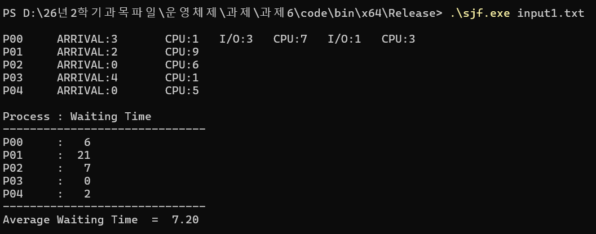

#### input2.txt: 반복되는 CPU burst와 I/O burst

여러 CPU burst와 I/O burst를 가진 프로세스를 함께 계산했습니다. waiting time은 P00부터 `21, 11, 2, 4, 3`으로 합계 41, 평균 8.20입니다. 도착 시각 2의 여러 프로세스도 파일 순서와 CPU burst time을 기준으로 처리합니다.

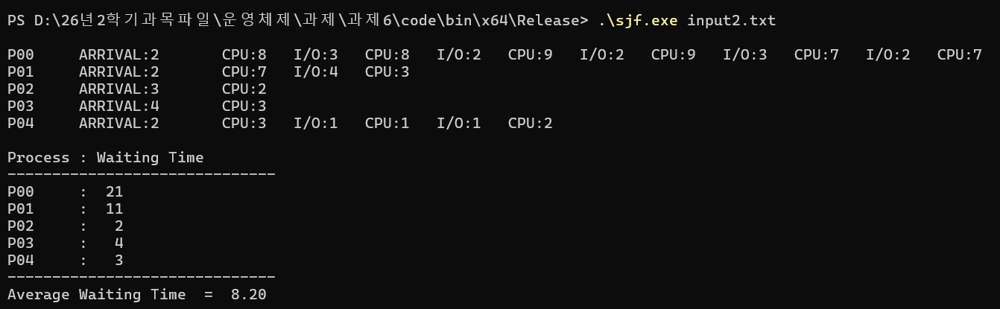

#### input3.txt: 과제 PDF의 실행 예제

프로세스 10개의 결과가 PDF 예제와 일치합니다. P00의 119, P03의 97을 포함한 전체 waiting time 합계는 500이고, 평균은 50.00입니다.

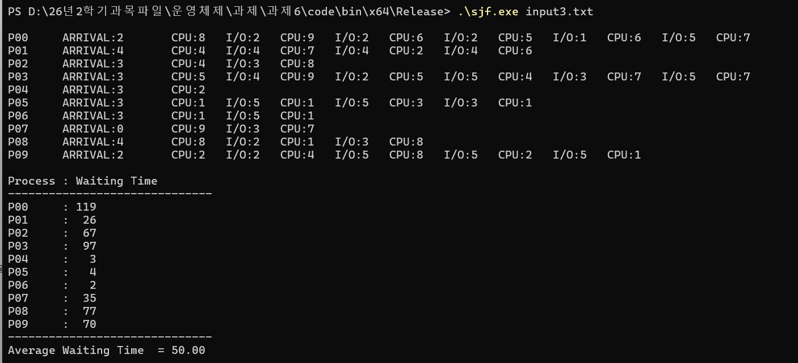

#### input4.txt: 긴 CPU burst·I/O burst 목록의 처리

CPU burst와 I/O burst가 여러 번 반복되어도 각 프로세스의 전체 waiting time을 누적합니다. P04의 waiting time은 247, P05는 238이며, 합계 1,408을 프로세스 10개로 나눈 평균 waiting time은 140.80입니다. 긴 입력 줄이 터미널 폭에 따라 다음 화면 줄로 이어지더라도 프로세스 하나의 입력 내용입니다.

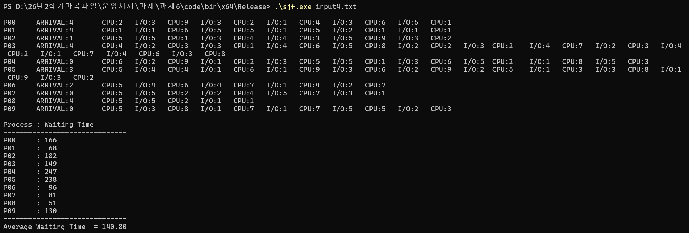

#### random.txt: 새로운 프로세스 15개

제공된 샘플보다 많은 프로세스를 가진 입력입니다. 도착 시각은 줄 순서대로 정렬되어 있지 않고, CPU burst 하나만 있는 프로세스와 CPU burst·I/O burst를 반복하는 프로세스를 섞었습니다. P06의 waiting time은 152, P14는 137이며, 합계 815를 15로 나누면 평균 waiting time은 소수점 둘째 자리까지 54.33입니다.

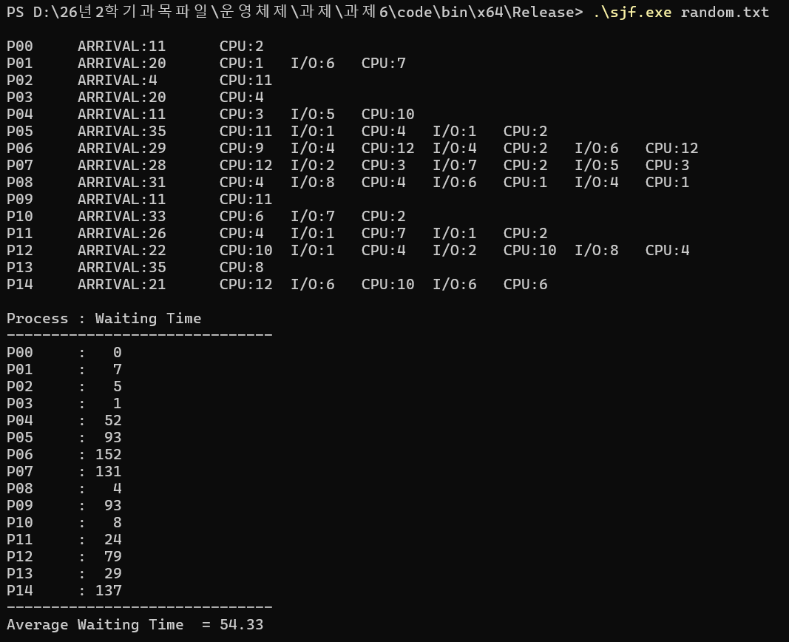

#### error.txt: 마지막 CPU burst가 빠진 입력

두 번째 프로세스가 `CPU:4 I/O:1`로 끝나도록 `error.txt`를 작성했습니다. 실행하자 처음과 마지막은 CPU burst여야 한다는 오류를 출력하고, waiting time 표와 평균은 출력하지 않은 채 종료했습니다.

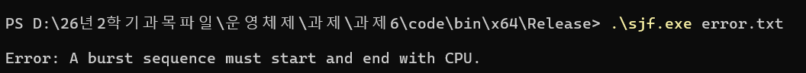

#### error_negative_time.txt: 음수 시간

`P00 ARRIVAL:0 CPU:-3`으로 CPU burst time에 음수를 입력했습니다. 프로그램은 시간이 0 이상의 64비트 정수여야 한다는 오류를 출력하고 종료했습니다.

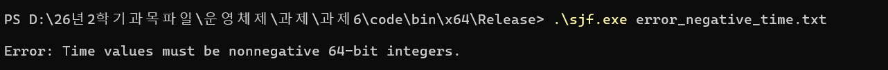

#### error_missing_arrival.txt: 도착 시각 누락

프로세스 이름 `P00`만 적고 `ARRIVAL:` 항목을 생략했습니다. 프로그램은 도착 시각이 빠졌다는 오류를 출력하고 종료했습니다.

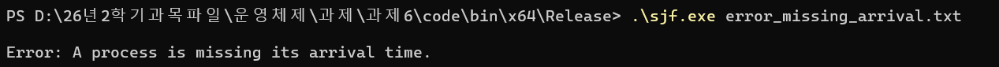

#### 입력 파일을 찾지 못한 경우

입력 파일 이름을 `erroe.txt`로 잘못 지정한 경우입니다. 해당 파일을 찾지 못해 파일을 열 수 없다는 오류를 출력하고 종료했습니다.

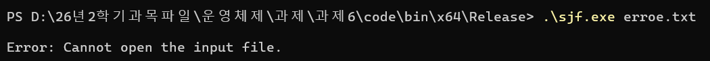

파일 열기 단계의 오류로, 앞에서 확인한 입력 내용의 형식 오류와 구분됩니다.

## 4. 사용자 설명

### 4.1 준비 환경

- Windows와 C++ 데스크톱 개발 기능이 설치된 Visual Studio
- Visual Studio Community 2026의 v145 도구 집합과 설치된 Windows SDK
- 프로그램 빌드·실행에는 추가 패키지나 Python이 필요하지 않음

프로젝트는 Visual Studio 2022에서는 v143, 2026에서는 v145를 선택하도록 설정했습니다. 빌드와 실행 검증은 Visual Studio Community 2026에서 수행했습니다. Python 3는 자동 검사를 다시 실행할 때만 필요합니다.

### 4.2 소스 내려받기

1. 저장소 상단의 `Code` 버튼을 누릅니다.
2. `Download ZIP`을 선택하고 압축을 풉니다.
3. `assignments\assignment-06\project` 폴더로 이동합니다.

이 폴더에 `input1.txt`부터 `input4.txt`, `random.txt`, `error.txt`와 추가 오류 입력 12개가 있습니다. 오류 입력의 실행 순서와 예상 메시지는 [ERROR_TESTS.md](project/ERROR_TESTS.md)에서 확인할 수 있습니다.

### 4.3 Visual Studio에서 컴파일

1. `sjf.sln`을 엽니다.
2. 솔루션 구성은 `Release`, 플랫폼은 `x64`를 선택합니다.
3. `빌드 > 솔루션 빌드` 또는 `Ctrl+Shift+B`를 누릅니다.
4. 빌드가 끝나면 다음 위치에 실행 파일이 만들어집니다.

```text
project\bin\x64\Release\sjf.exe
```

IDE에서 실행하려면 프로젝트 속성의 `디버깅 > 명령 인수`에 `input1.txt`, `작업 디렉터리`에 `$(ProjectDir)`를 지정한 뒤 `Ctrl+F5`를 누릅니다. 다른 입력은 명령 인수의 파일 이름을 바꿉니다. 개인별 디버깅 설정인 `.vcxproj.user`는 저장소에 포함하지 않았습니다.

### 4.4 PowerShell에서 실행

`project` 폴더에서 PowerShell을 열고 다음 명령을 실행합니다.

```powershell
.\bin\x64\Release\sjf.exe input1.txt
.\bin\x64\Release\sjf.exe input2.txt
.\bin\x64\Release\sjf.exe input3.txt
.\bin\x64\Release\sjf.exe input4.txt
.\bin\x64\Release\sjf.exe random.txt
.\bin\x64\Release\sjf.exe error.txt
```

앞의 다섯 입력은 정상 계산, 마지막 입력은 의도한 형식 오류를 보여 줍니다. 다른 오류는 [파일별 실행 안내](project/ERROR_TESTS.md)에 있는 명령으로 확인합니다. 실행 파일이 있는 폴더에서 파일 이름만 쓰려면 입력 파일도 그 폴더에 복사한 뒤 실행합니다.

```powershell
.\sjf.exe input1.txt
```

PowerShell에서는 현재 폴더의 실행 파일 앞에 `.\`를 붙입니다. 입력 경로에 공백이 있으면 큰따옴표로 감쌉니다. 입력 파일은 실행 파일 위치가 아니라 **명령을 실행한 현재 폴더를 기준으로** 찾습니다.

### 4.5 명령 프롬프트에서 실행

`project` 폴더에서 명령 프롬프트를 열고 실행합니다.

```bat
bin\x64\Release\sjf.exe input1.txt
bin\x64\Release\sjf.exe random.txt
bin\x64\Release\sjf.exe error.txt
```

실행 파일과 입력이 현재 폴더에 함께 있으면 다음처럼 실행할 수 있습니다.

```bat
sjf.exe input1.txt
```

한 번에 읽는 입력 파일은 하나입니다. 여러 입력의 결과를 보고 싶으면 파일마다 명령을 한 번씩 실행합니다.

### 4.6 새 입력 만들기와 결과 확인

다음 내용을 `new.txt`로 저장합니다.

```text
A ARRIVAL:0 CPU:8
B ARRIVAL:2 CPU:2
```

```powershell
.\bin\x64\Release\sjf.exe new.txt
```

A가 실행되다가 시각 2에 CPU burst time이 더 짧은 B가 Ready Queue에 들어오면, A의 CPU를 회수하고 B를 즉시 실행합니다. A의 waiting time은 2, B는 0, 평균 waiting time은 1.00입니다. `CPU:8 I/O:2 CPU:3`처럼 CPU burst와 I/O burst를 반복할 수 있지만, 처음과 마지막은 CPU burst여야 합니다.

화면에서는 먼저 입력 목록을, 다음으로 `Process : Waiting Time` 표와 평균을 확인합니다. 표는 도착이나 종료 순서가 아닌 **입력 파일의 줄 순서**입니다. 한 번 계산한 뒤 자동 종료하며, 별도 종료 키를 누를 필요가 없습니다.

### 4.7 문제 해결과 검사 다시 실행하기

- 파일을 열 수 없다는 오류가 나오면 파일 이름·확장자·현재 폴더를 확인합니다. `erroe.txt`처럼 파일 이름을 잘못 적지 않았는지도 확인합니다.
- 처음과 마지막이 CPU burst여야 한다는 오류가 나오면 마지막 I/O burst 뒤에 CPU burst가 빠지지 않았는지 확인합니다.
- 항목 오류가 나오면 `ARRIVAL:`, `CPU:`, `I/O:`의 철자와 순서, 콜론 뒤 숫자를 확인합니다.
- 시간 값 오류가 나오면 음수·소수·문자나 표현 범위를 넘는 큰 정수가 없는지 확인합니다.
- 창이 바로 닫히면 PowerShell이나 명령 프롬프트를 먼저 열고 실행합니다.
- 실행 파일을 찾지 못하면 빌드 성공 여부와 `bin\x64\Release\sjf.exe` 위치를 확인합니다.
- 빌드 도구나 SDK를 찾지 못하면 Visual Studio Installer의 C++ 데스크톱 개발 기능과 프로젝트의 도구 집합·SDK 선택을 확인합니다.

자동 검사는 Python 3의 표준 라이브러리만 사용합니다. 각 구성을 먼저 빌드한 뒤 `project` 폴더에서 다음과 같이 실행합니다.

```bat
python tests/verify.py
python tests/verify.py --exe bin/x64/Debug/sjf.exe
```

각 명령은 145개 검사를 수행하고, 실패하면 해당 입력과 결과를 알려 줍니다. 검사용 임시 입력은 `project/tmp` 안에 만들고 검사 종료 시 정리합니다. 기본 검사 145개와 보고서의 `random.txt` 시연은 구분되어 있습니다.

## 5. 자기 평가

### 독창성: 90 / 100

이번 프로그램에서는 SJF의 다음 CPU burst time 기준과 Preemptive SJF의 남은 시간 비교를 함께 구현했습니다. New에서 도착하거나 I/O를 마친 프로세스는 다음 CPU burst time으로, CPU를 회수당한 프로세스는 중단된 CPU burst의 남은 시간으로 비교했습니다. CPU burst time 순서로 한 번 정렬하는 방식에 그치지 않고, 새 도착과 I/O 완료 때마다 실행 중인 프로세스의 남은 CPU burst time과 다시 비교했습니다. CPU를 회수당한 프로세스는 나중에 같은 CPU burst를 이어서 실행되도록 상태를 관리했습니다.

동일한 시각에는 새 도착, I/O 완료와 CPU를 회수당한 프로세스를 순서대로 Ready Queue에 넣었습니다. CPU 선택은 CPU burst time 비교를 우선하고, 비교 값이 같은 Ready Queue의 프로세스들 사이에서만 진입 순서를 적용했습니다. 현재 Running과 비교 값이 같을 때는 실행을 유지하는 조건도 구분했습니다. 여러 I/O burst는 각자의 완료 시각을 가지게 해 CPU는 하나이고 I/O는 병렬이라는 조건을 함께 반영했습니다.

waiting time은 Ready Queue에서 CPU를 할당받을 때마다 진입 시각과의 차이를 더하는 방식으로 계산했습니다. CPU burst time과 I/O burst time을 포함하지 않도록 구분했고, 별도의 검사에서는 매 시간 Ready Queue에 있는 프로세스의 waiting time을 세는 방법 및 종료 시각을 이용한 식과 비교했습니다. 제공 예제뿐 아니라 다른 크기의 무작위 입력, 같은 시각의 진입과 큰 시간 값도 확인했습니다.

입력 읽기, 스케줄링, 출력과 전체 실행 흐름을 나누고 주석에는 각 부분의 역할과 규칙을 적었습니다. 변화가 없는 시간 구간은 다음 사건 시각으로 건너뛰어 긴 시간 값도 처리할 수 있게 했습니다. 잘못된 파일 이름과 입력 형식에 대한 오류 처리도 추가하고, 실제 실행 사진과 반복 가능한 검사 기록을 함께 정리했습니다.

기본 알고리즘으로 과제에서 지정한 Preemptive SJF를 사용했으므로 알고리즘 자체를 새로 고안한 것은 아닙니다. Ready Queue에서 CPU burst time의 비교 값이 최소인 프로세스를 매번 순회해 찾기 때문에 아주 많은 프로세스에서는 더 효율적인 자료구조를 고려할 수 있으며, 실제 운영체제의 문맥 교환 비용과 CPU burst time 예측은 모델에 포함하지 않았습니다. 이러한 범위를 반영하되 Preemptive 동작과 동률 처리, 병렬 I/O burst, waiting time 계산과 검증을 함께 갖춘 점을 근거로 90점으로 평가했습니다.
