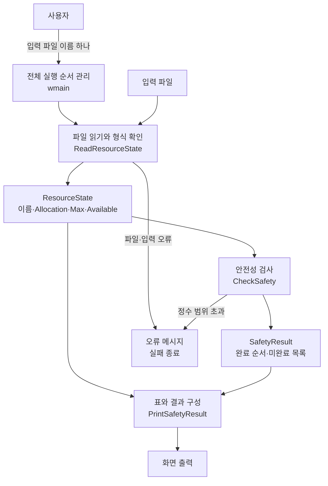
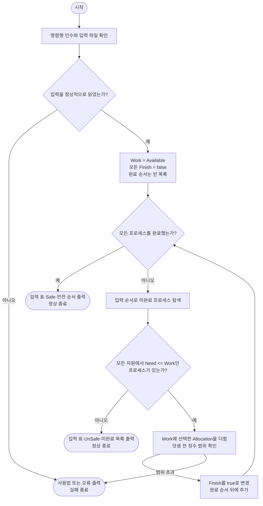
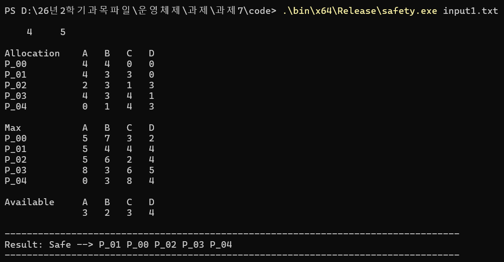
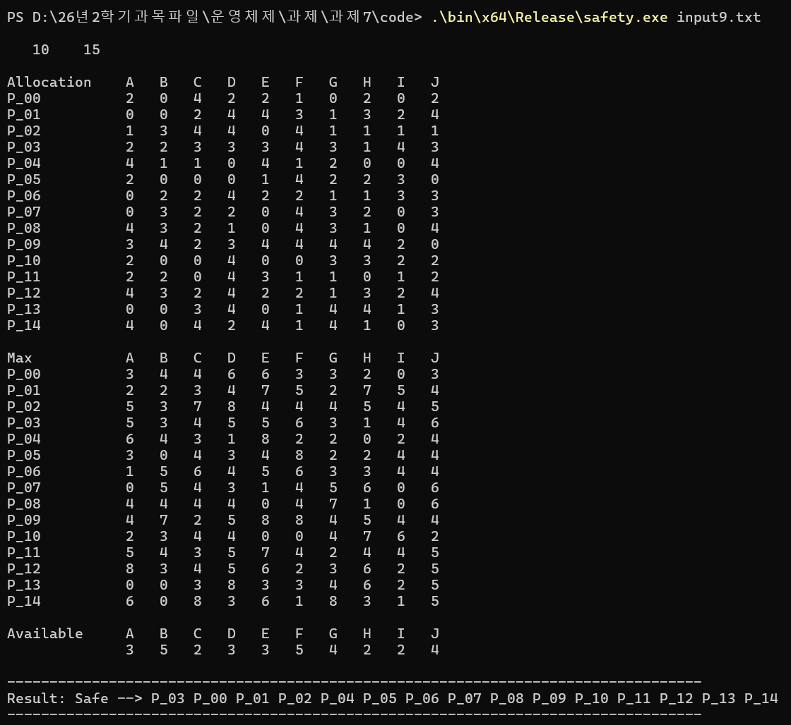

# Programming Assignment 07

## Safety Algorithm

| 구분 | 내용 |
|---|---|
| 과목 | DCCS301 Operating System |
| 작성자 | 전남규 |
| 학번 | 2020271319 |
| 개발 언어 | C++17 |
| 개발 환경 | Windows, Visual Studio Community 2026 |
| 빌드 구성 | Release / x64 |
| 실행 파일 | `safety.exe` |

파일에 저장된 자원 할당 상태를 읽어 모든 프로세스의 완료를 보장할 수 있는지 검사하는 콘솔 프로그램입니다. 은행원 알고리즘의 안전성 검사를 구현했으며, 안전 상태에서는 프로세스의 안전 순서를, 불안전 상태에서는 완료를 보장하지 못한 프로세스 목록을 출력합니다.

## 목차

1. [프로그램 개요](#1-프로그램-개요)
2. [시스템 설명](#2-시스템-설명)
3. [테스트 결과 설명](#3-테스트-결과-설명)
4. [사용자 설명](#4-사용자-설명)
5. [자기 평가](#5-자기-평가)

## 1. 프로그램 개요

프로세스가 이미 가진 자원과 앞으로 필요로 할 수 있는 최대 자원, 현재 남아 있는 자원을 바탕으로 안전성을 판단하도록 구현했습니다. 남은 자원으로 완료할 수 있는 프로세스를 찾고, 그 프로세스가 자원을 반납한다고 가정하면서 다른 프로세스도 차례로 완료할 수 있는지 확인합니다.

| 용어 | 의미 |
|---|---|
| Resource Type | A, B, C처럼 서로 구분되는 자원의 종류입니다. 같은 종류에 여러 개의 자원이 있을 수 있습니다. |
| Allocation | 각 프로세스가 현재 가지고 있는 자원의 개수입니다. |
| Max | 각 프로세스가 완료할 때까지 필요로 할 수 있는 최대 자원의 개수입니다. 이미 가진 자원도 포함합니다. |
| Available | 아직 할당되지 않아 지금 사용할 수 있는 자원의 개수입니다. |
| Need | 앞으로 더 필요할 수 있는 자원으로, `Max - Allocation`입니다. |
| Safe Sequence | 필요한 자원을 차례로 제공하면서 모든 프로세스를 완료시킬 수 있는 순서입니다. |

예를 들어 현재 남은 A 자원이 1개이고, P_00은 1개를 더 받으면 완료할 수 있지만 P_01은 2개를 더 받아야 한다면 P_00부터 확인합니다. P_00이 완료하면서 가진 자원을 반납하면 P_01도 완료할 수 있는지 다시 검사합니다. 처음에 모든 프로세스의 요구를 한꺼번에 충족해야 하는 것은 아닙니다.

안전성 검사와 자원 요청 처리는 구분했습니다. 이 프로그램은 입력에 기록된 현재 상태를 검사하며, 실행 중 새로운 자원 요청을 받아 승인하거나 실제 Windows 프로세스에 자원을 할당하지는 않습니다.

주요 기능은 다음과 같습니다.

- 실행할 때 입력 파일 하나를 명령행 인수로 지정합니다.
- 자원 종류 수와 프로세스 수에 맞춰 Allocation, Max, Available을 읽습니다.
- 모든 자원에서 `Need <= Work`인 프로세스를 찾아 완료와 자원 반납을 가정합니다.
- 모든 프로세스가 완료 가능하면 `Safe`와 안전 순서 하나를 출력합니다.
- 더 완료할 수 없으면 `UnSafe`와 남은 프로세스들을 입력 순서로 출력합니다.
- 입력 표와 판정 결과를 화면에 표시하며, 전체 출력 앞뒤에 빈 줄을 하나씩 둡니다.
- 입력 읽기, 안전성 계산, 화면 출력을 나누고 파일 오류와 정수 범위 초과를 처리합니다.

**UnSafe는 현재 이미 교착 상태라는 뜻이 아닙니다.** 각 프로세스가 최대 필요량까지 요구할 때 모두의 완료를 보장할 수 없다는 뜻입니다. 안전 순서는 여러 개일 수 있으며, 이 프로그램에서는 매 단계에 입력 순서가 가장 앞선 완료 가능 프로세스를 선택합니다.

## 2. 시스템 설명

### 2.1 시스템 구성

실행 흐름, 입력 상태 저장, 파일 읽기, 안전성 검사와 화면 출력을 나누었습니다. 시작 함수인 `wmain`에서 파일을 읽고 검사한 뒤 결과를 출력하도록 연결했습니다.

| 구성 요소 | 역할 |
|---|---|
| [main.cpp](project/src/main.cpp) | 명령행 인수를 확인하고 파일 읽기·검사·출력을 연결합니다. 실행 중 발생한 예외를 받아 오류를 알립니다. |
| [ResourceState.h](project/src/ResourceState.h) | 자원·프로세스 이름, Allocation, Max와 Available을 저장합니다. |
| [ResourceFile](project/src/ResourceFile.cpp) | 표 제목, 이름과 자원 개수를 읽고 표 사이의 순서와 값의 조건을 확인합니다. |
| [SafetyAlgorithm](project/src/SafetyAlgorithm.cpp) | Work와 Finish를 관리하며 완료 가능한 순서와 미완료 목록을 구합니다. |
| [StatePrinter](project/src/StatePrinter.cpp) | 원래 입력 표, Safe 또는 UnSafe, 해당 프로세스 목록을 출력합니다. |

입력 상태는 계산 도중 바꾸지 않습니다. 안전성 검사는 Available의 복사본인 Work를 늘려 가며 수행하고, 화면에는 파일에 적혀 있던 원래 상태를 보여 줍니다. 외부 라이브러리는 추가하지 않았습니다.

### 2.2 사용한 C++ 기능

파일 읽기, 자료 저장과 출력에는 C++ 표준 라이브러리를 사용했습니다. 시작 함수는 Windows에서 넓은 문자열 형태의 명령행 인수를 받을 수 있는 `wmain`입니다. `wmain`은 Microsoft 확장 기능이며, `wchar_t* argv[]`로 받은 경로를 `std::filesystem::path`에 전달합니다.

| 기능 | 사용한 이유 |
|---|---|
| `wmain` | 한글이나 공백이 포함된 입력 파일 경로를 받습니다. |
| `std::filesystem::path` | 입력 경로를 파일 스트림에 전달합니다. |
| `std::ifstream`, `operator >>` | 이름과 정수를 읽고 공백·탭·줄바꿈으로 항목을 구분합니다. |
| `std::vector` | 입력에 적힌 행·열 개수에 맞춰 표와 검사 상태를 저장합니다. |
| `std::int64_t` | 자원 개수와 자원 반납 후의 합계를 64비트 정수로 계산합니다. |
| `std::numeric_limits` | 자원을 더하기 전에 표현 가능한 정수 범위를 확인합니다. |
| `std::ostringstream` | 표와 결과 문구를 문자열로 완성한 뒤 출력합니다. |
| `std::setw`, `std::left`, `std::right` | 이름과 자원 값의 칸 간격과 정렬 방향을 맞춥니다. |
| 예외 처리 | 파일 읽기·계산·출력 실패를 시작 함수에서 함께 처리합니다. |

프로그램을 빌드하거나 실행하는 데 Python은 필요하지 않습니다. Python은 별도로 작성한 자동 검사에서만 사용합니다.

### 2.3 데이터 흐름도



### 2.4 프로그램 순서도



Safe와 UnSafe는 모두 검사를 정상적으로 마친 결과이므로 종료 코드는 0입니다. 파일을 읽지 못하거나 계산할 수 없는 값이 들어온 경우에는 오류를 출력하고 종료 코드 1을 반환합니다.

### 2.5 주요 클래스와 함수

| 자료형·함수 | 입력 | 반환값 | 역할 |
|---|---|---|---|
| `wmain` | 명령행 인수 | 종료 코드 | 입력 파일 하나를 받아 읽기·계산·출력을 실행합니다. |
| `ResourceState` | 파일에서 읽은 정보 | 입력 상태 구조체 | 자원 이름과 프로세스 이름, 두 표와 가용 자원을 보관합니다. |
| `ResourceCount` | 자원 개수 | 64비트 정수 | 입력 값과 Work의 계산에 같은 정수 형식을 사용합니다. |
| `ReadCount` | 입력 스트림 | 0 이상의 정수 | 값을 읽을 수 있는지와 음수 여부를 확인합니다. |
| `ReadHeader` | 입력 스트림, 예상 제목, 열 개수 | 자원 이름 목록 | 표 제목과 열 이름을 읽습니다. |
| `ReadResources` | 입력 스트림, 열 개수 | 자원 개수 한 행 | Allocation·Max의 각 행과 Available을 읽습니다. |
| `ReadResourceState` | 입력 파일 경로 | `ResourceState` | 파일 전체를 읽고 표의 이름과 값의 조건을 확인합니다. |
| `SafetyResult` | 검사 과정의 결과 | 결과 구조체 | 완료 순서와 끝까지 완료하지 못한 프로세스 번호를 나눠 보관합니다. |
| `CheckSafety` | 입력 상태 | `SafetyResult` | 완료 가능 여부를 반복 검사하고 자원 반납을 가정합니다. |
| `PrintRow` | 행 이름, 값 목록, 출력 대상 | 없음 | 자원 이름 행과 숫자 행의 간격을 맞춥니다. |
| `PrintTable` | 표 제목, 값, 입력 상태, 출력 대상 | 없음 | 제목과 프로세스별 행을 원래 입력 순서로 출력합니다. |
| `PrintSafetyResult` | 입력 상태, 검사 결과, 출력 대상 | 없음 | 입력 표와 판정 결과를 하나의 화면으로 구성합니다. |

`ReadCount`, `ReadHeader`, `ReadResources`, `PrintRow`와 `PrintTable`은 각각의 구현 파일 안에서만 사용합니다. 결과 구조체에는 이름을 중복 저장하지 않고 입력 상태의 행 번호를 보관합니다.

### 2.6 입력 형식과 읽기

첫 줄에는 자원 종류 수 `m`과 프로세스 수 `n`을 차례로 적습니다. 그 뒤에 Allocation, Max, Available을 둡니다. [input-custom.txt](project/input-custom.txt)의 초기 내용은 다음과 같습니다.

```text
3 3

Allocation A B C
P_00 1 0 0
P_01 0 1 0
P_02 0 0 1

Max A B C
P_00 2 1 0
P_01 0 1 1
P_02 1 0 1

Available A B C
1 0 0
```

자원 종류는 A, B, C의 3개이고 프로세스도 3개입니다. P_00은 A를 1개 가지고 있으며 완료할 때까지 A 2개와 B 1개가 필요할 수 있습니다. 현재 남은 자원은 A 1개, B 0개, C 0개입니다.

- Allocation과 Max에는 프로세스마다 자원 개수 `m`개를 적습니다.
- Max는 앞으로 추가로 필요한 양이 아니라 이미 가진 자원을 포함한 최대량입니다.
- Available에는 프로세스 이름 없이 자원 개수 `m`개만 적습니다.
- 세 표의 자원 이름과 순서, 두 프로세스 표의 이름과 순서는 같아야 합니다.
- 각 자원 값은 0 이상의 정수이며, `Max >= Allocation`이어야 합니다.
- 항목은 공백이나 탭으로 구분하며 빈 줄과 줄 끝 공백을 허용합니다.
- UTF-8 파일 시작 표시가 있으면 건너뛰고 첫 숫자부터 읽습니다.

행·열 크기는 첫 줄의 숫자로 정합니다. 프로세스 이름이나 자원 이름을 코드 안에서 생성하지 않고 파일에서 읽기 때문에 다른 크기와 이름의 입력도 같은 방식으로 검사합니다.

### 2.7 Need, Work와 Finish

안전성 검사에는 다음 세 값을 사용합니다.

```text
Need[i][j] = Max[i][j] - Allocation[i][j]
Work[j] = 현재 검사 단계에서 사용할 수 있는 j번째 자원
Finish[i] = i번째 프로세스의 완료를 이미 가정했는지 나타내는 값
```

처음에는 Work를 Available로 복사하고 모든 Finish를 false로 둡니다. 아직 완료하지 않은 프로세스에 대해 모든 자원에서 다음 조건을 확인합니다.

```text
Need[i][j] <= Work[j]
```

값이 같은 경우에도 필요한 만큼 자원을 줄 수 있으므로 완료 가능합니다. 한 종류라도 부족하면 그 프로세스는 건너뛰고 다음 후보를 살펴봅니다. Need는 별도의 표에 복사하지 않고 비교할 때 Max에서 Allocation을 빼서 구합니다.

```cpp
const ResourceCount need = state.maximum[i][j] - state.allocation[i][j];
if (need > work[j]) {
    canFinish = false;
    break;
}
```

Finish가 true인 프로세스는 다시 고르지 않습니다. 그래야 같은 프로세스를 결과에 두 번 넣거나 가진 자원을 두 번 반납받지 않습니다.

### 2.8 자원 반납과 안전 순서

완료 가능한 프로세스를 선택하면 Work에 그 프로세스의 Allocation을 더하고, Finish를 true로 바꾼 뒤 완료 순서 뒤에 기록합니다.

```text
완료 후 Work = 완료 전 Work - Need + (Allocation + Need)
             = 완료 전 Work + Allocation
```

추가로 빌려 준 Need는 완료하면서 다시 돌아오기 때문에 상쇄됩니다. Max 전체를 Work에 더하면 빌려 준 양까지 중복해서 늘어나므로 Allocation만 더합니다.

`input-custom.txt`에서는 다음 순서로 모든 프로세스가 완료 가능합니다.

| 단계 | 선택한 프로세스 | Need (A, B, C) | 선택 전 Work | 완료 후 Work |
|---:|---|---|---|---|
| 1 | P_02 | (1, 0, 0) | (1, 0, 0) | (1, 0, 1) |
| 2 | P_01 | (0, 0, 1) | (1, 0, 1) | (1, 1, 1) |
| 3 | P_00 | (1, 1, 0) | (1, 1, 1) | (2, 1, 1) |

처음에는 P_00과 P_01이 필요한 자원을 받지 못하지만 P_02가 끝난 다음에는 상황이 달라집니다. 따라서 프로세스를 한 번만 순회하지 않고, 반납 처리가 끝날 때마다 첫 번째 프로세스부터 다시 찾도록 구현했습니다. 안전 순서는 `P_02 P_01 P_00`입니다.

### 2.9 불안전 상태와 남은 프로세스

미완료 프로세스를 전부 확인해도 완료 가능한 후보가 없으면 반복을 끝냅니다. Work를 더 늘릴 프로세스가 없으므로 같은 검사를 계속해도 상태가 바뀌지 않습니다.

반복을 끝낸 다음 Finish가 false인 프로세스만 입력 순서대로 모읍니다. 일부 프로세스를 완료할 수 있었다고 해서 나머지까지 안전한 것은 아니며, 불안전 목록에 이미 완료한 프로세스를 포함하지도 않습니다.

예를 들어 [input5.txt](project/input5.txt)에서는 P_04 → P_03 → P_01의 완료를 가정할 수 있습니다. 이때 Work는 `(4, 11, 2, 8)`이 됩니다. 남은 두 프로세스의 Need는 다음과 같습니다.

| 프로세스 | Need (A, B, C, D) | 남은 이유 |
|---|---|---|
| P_00 | (4, 2, 3, 3) | C가 3개 필요하지만 Work에는 2개만 있습니다. |
| P_02 | (3, 4, 4, 1) | C가 4개 필요하지만 Work에는 2개만 있습니다. |

최종 출력은 다음과 같습니다.

```text
Result: UnSafe --> P_00 P_02
```

완료를 가정한 P_04, P_03, P_01은 이 목록에 들어가지 않습니다. 전체 입력과 출력은 [실행 결과](test-results/input5.txt)에 남겼습니다.

### 2.10 화면 출력

먼저 자원 종류 수와 프로세스 수, Allocation, Max, Available을 입력 순서로 보여 줍니다. 그 뒤 82개의 하이픈으로 된 구분선 사이에 상태와 프로세스 목록을 출력합니다.

- 이름 칸은 최소 12칸을 사용해 왼쪽에 정렬합니다.
- 각 자원 칸은 최소 3칸을 사용해 오른쪽에 정렬하고 칸 사이를 한 칸 띕니다.
- 안전 상태는 `Result: Safe -->`, 불안전 상태는 `Result: UnSafe -->`로 시작합니다.
- 프로세스 이름은 파일에서 읽은 그대로 표시합니다.
- 전체 출력 시작 전과 마지막 구분선 뒤에 빈 줄을 하나씩 둡니다.

출력 함수에는 입력 상태와 계산 결과만 전달합니다. 정답 파일은 자동 검사에서 출력과 비교할 때 사용하며, 실행 파일이 결과를 구하는 과정에는 사용하지 않습니다. 결과 파일을 따로 만드는 기능도 넣지 않았습니다. 저장소의 출력 텍스트는 검증 과정에서 화면 출력을 받아 기록한 파일입니다.

### 2.11 오류 처리와 효율성

| 입력·실행 상황 | 처리 |
|---|---|
| 입력 파일 인수가 없거나 둘 이상 | 사용법을 출력하고 종료 코드 1로 끝냅니다. |
| 입력 파일을 열 수 없음 | `Cannot open the input file.` 오류를 출력합니다. |
| 필요한 숫자나 이름이 빠진 파일 | 읽기를 중단하고 입력 오류를 알립니다. |
| 음수 자원 값 또는 읽을 수 없는 정수 | 0 이상의 정수가 필요하다는 오류를 출력합니다. |
| 표 제목이나 자원·프로세스 이름의 순서가 다름 | 예상한 표와 이름이 아니라는 오류를 출력합니다. |
| Max가 Allocation보다 작음 | 잘못된 최대량으로 처리하고 검사를 시작하지 않습니다. |
| Available 뒤에 불필요한 내용이 있음 | 남은 내용이 있다는 오류를 출력합니다. |
| 자원 반납의 합이 64비트 정수 범위를 넘음 | 덧셈 전에 중단하고 범위 초과를 알립니다. |

파일은 읽기 전용으로 열고 전체 상태를 읽은 뒤 계산합니다. 오류가 나면 정상 결과 표를 출력하지 않습니다. 출력 내용을 문자열로 먼저 모으지만, 실제 출력 대상에 쓰는 도중 발생한 장애에서 이미 전달한 문자까지 되돌리지는 못합니다.

프로세스 수를 `n`, 자원 종류 수를 `m`이라고 하면 표를 읽는 시간과 저장 공간은 `O(n × m)`입니다. 안전성 검사는 매번 최대 `n`개 프로세스의 자원 `m`개를 확인하고 최대 `n`개의 완료를 처리하므로 시간은 `O(n² × m)`입니다. 입력 표 외에 Work, Finish와 결과 목록에 필요한 추가 공간은 `O(m + n)`입니다.

프로세스와 자원을 고정 크기 배열로 제한하지 않았습니다. 다만 실제 처리 가능한 크기는 메모리와 실행 시간에 영향을 받고, 자원 개수와 반납 합계는 부호 있는 64비트 정수 범위 안에서 처리합니다.

### 2.12 프로젝트 구조

```text
assignment-07/
├─ README.md
├─ images/
│  ├─ safety-input1.png
│  └─ safety-input9.png
├─ test-results/
│  ├─ release.json / debug.json
│  ├─ release-build.txt / debug-build.txt
│  ├─ release-verification.txt / debug-verification.txt
│  ├─ demonstrations.json
│  ├─ manual-captures.json
│  ├─ input1.txt ~ input9.txt
│  └─ input-custom.txt
└─ project/
   ├─ safety.sln
   ├─ safety.vcxproj
   ├─ safety.vcxproj.filters
   ├─ input1.txt ~ input9.txt
   ├─ input-custom.txt
   ├─ 입력파일_사용법.txt
   ├─ src/
   │  ├─ main.cpp
   │  ├─ ResourceState.h
   │  ├─ ResourceFile.h / ResourceFile.cpp
   │  ├─ SafetyAlgorithm.h / SafetyAlgorithm.cpp
   │  └─ StatePrinter.h / StatePrinter.cpp
   ├─ test-data/
   │  ├─ input/input1.txt ~ input9.txt
   │  ├─ expected/ret-input1.txt ~ ret-input9.txt
   │  └─ pdf-safe.txt
   └─ tests/
      └─ verify.py
```

[전체 소스 코드 보기](project/src)

프로젝트 바로 아래에는 예제 입력 9개와 직접 수정할 수 있는 연습용 입력 1개를 두었습니다. `test-data`는 자동 검사용 입력과 기준 출력을 보관합니다. 저장소에는 실행 파일, 개인 디버깅 설정, 임시 입력과 빌드 중간 파일을 포함하지 않았습니다.

## 3. 테스트 결과 설명

### 3.1 테스트 환경

| 항목 | 환경 |
|---|---|
| 검증일 | 2026-11-23 |
| 운영체제 | Windows / x64 |
| IDE | Visual Studio Community 2026 |
| 도구 집합 | MSVC v145 |
| 언어 표준 | C++17 |
| 검증 구성 | Debug / x64, Release / x64 |
| 컴파일 검사 | 경고 수준 `/W4`, 경고를 오류로 처리하는 `/WX` |
| Release 런타임 | 실행 지원 기능을 실행 파일에 포함하는 `/MT` 방식 |
| 기준 비교 | 예제 9개의 기준 출력, 가능한 완료 순서를 모두 탐색하는 Python 계산 |

저장소에 넣을 프로젝트 복사본에서 Debug와 Release를 각각 빌드하고 같은 자동 검사를 실행했습니다. 개발 중 만들어 둔 실행 파일을 그대로 복사하지 않고, 포함할 소스로 다시 빌드해 결과를 확인했습니다. Visual Studio 2022용 도구 집합 선택도 프로젝트에 들어 있지만 실제 빌드와 실행 검증은 2026에서 수행했습니다.

### 3.2 빌드와 실제 출력 테스트

| 테스트 | 확인한 결과 | 판정 |
|---|---|:---:|
| Release / x64 빌드 | `safety.exe` 생성, 빌드 성공 | 통과 |
| Debug / x64 빌드 | 같은 소스로 빌드 성공 | 통과 |
| 예제 입력 9개 | 상태와 프로세스 목록이 기준 출력과 일치 | 통과 |
| 화면 형식 | 표의 공백, 결과 순서, 구분선과 앞뒤 빈 줄 일치 | 통과 |
| 추가 안전 입력 | 프로세스 10개의 안전 순서 일치 | 통과 |
| 경계 입력 7개와 무작위 입력 200개 | 별도 완전 탐색 계산과 일치 | 통과 |
| 자원 25종류, 프로세스 120개 | 전체 프로세스를 한 번씩 출력 | 통과 |
| 인수·파일·값·범위 오류 9개 | 정상 결과 없이 오류와 실패 종료 | 통과 |

예제 9개의 전체 화면을 기준 출력과 비교했습니다. 운영체제의 줄바꿈 차이는 통일하고, 전체 출력 앞뒤에 빈 줄을 하나씩 반영한 뒤 문자 단위로 비교했습니다. 표의 칸 간격과 프로세스 이름 뒤 공백도 검사에 포함했습니다.

| 입력 | 자원 종류 수 | 프로세스 수 | 상태 | 출력한 순서 또는 남은 목록 | 실제 출력 |
|---|---:|---:|---|---|---|
| [input1.txt](project/input1.txt) | 4 | 5 | Safe | P_01 → P_00 → P_02 → P_03 → P_04 | [결과](test-results/input1.txt) |
| [input2.txt](project/input2.txt) | 4 | 5 | Safe | P_00 → P_01 → P_02 → P_03 → P_04 | [결과](test-results/input2.txt) |
| [input3.txt](project/input3.txt) | 4 | 5 | UnSafe | P_00, P_01, P_03 | [결과](test-results/input3.txt) |
| [input4.txt](project/input4.txt) | 4 | 5 | UnSafe | P_00부터 P_04까지 모두 남음 | [결과](test-results/input4.txt) |
| [input5.txt](project/input5.txt) | 4 | 5 | UnSafe | P_00, P_02 | [결과](test-results/input5.txt) |
| [input6.txt](project/input6.txt) | 10 | 15 | Safe | P_02 → P_03으로 시작해 15개 모두 완료 | [결과](test-results/input6.txt) |
| [input7.txt](project/input7.txt) | 10 | 15 | Safe | P_04 → P_01 → P_00으로 시작해 15개 모두 완료 | [결과](test-results/input7.txt) |
| [input8.txt](project/input8.txt) | 10 | 15 | UnSafe | P_00부터 P_14까지 모두 남음 | [결과](test-results/input8.txt) |
| [input9.txt](project/input9.txt) | 10 | 15 | Safe | P_03 → P_00으로 시작해 15개 모두 완료 | [결과](test-results/input9.txt) |

기본 예제에서는 Safe 5개와 UnSafe 4개를 확인했습니다. 별도로 작성한 [input-custom.txt](project/input-custom.txt)는 `P_02 P_01 P_00` 순서로 완료되며, [실제 출력](test-results/input-custom.txt)을 함께 기록했습니다.

빌드와 자동 검사 기록은 [Release](test-results/release.json), [Debug](test-results/debug.json)에, 개별 실행 명령과 종료 코드는 [입력별 실행 기록](test-results/demonstrations.json)에 정리했습니다.

### 3.3 경계 입력, 무작위 입력과 오류 처리 테스트

C++ 구현은 입력 순서가 앞선 완료 가능 프로세스를 하나씩 선택합니다. 검사용 Python 코드에서는 선택 가능한 모든 후보의 분기를 탐색해 어떤 프로세스까지 완료할 수 있는지 따로 구했습니다. Safe이면 출력한 순서의 매 단계에서 자원이 충분한지도 확인하고, UnSafe이면 완전 탐색에서도 완료하지 못한 프로세스 목록과 비교했습니다.

| 입력·상황 | 확인한 내용 | 판정 |
|---|---|:---:|
| 뒤쪽 프로세스가 먼저 완료되어야 하는 입력 | 반납 후 처음으로 돌아가 앞선 프로세스를 다시 선택 | 통과 |
| 일부만 완료 가능한 입력 | 이미 완료한 프로세스를 UnSafe 목록에서 제외 | 통과 |
| Need와 Work가 같은 입력 | `<=` 조건으로 완료 처리 | 통과 |
| Need가 모두 0인 입력 | Available이 0이어도 완료 가능 | 통과 |
| 자원 값 3,000,000,000 | 32비트 범위를 넘는 값과 반납 결과 계산 | 통과 |
| 아무도 완료할 수 없는 입력 | 반복을 끝내고 전체 미완료 목록 출력 | 통과 |
| 프로세스 이름을 Worker로 변경 | 이름을 고정하지 않고 입력에서 읽어 출력 | 통과 |
| 고정 난수 입력 200개 | 상태와 목록이 완전 탐색 결과와 일치 | 통과 |
| 자원 25종류·프로세스 120개 | 행·열 크기에 맞게 읽고 120개 이름 출력 | 통과 |
| 한글과 공백이 포함된 경로 | 입력 파일을 열어 동일한 결과 출력 | 통과 |
| 탭·UTF-8 시작 표시·CRLF·추가 빈 줄 | 네 가지 형식 변형의 결과가 원본과 일치 | 통과 |

무작위 입력은 프로세스 1~7개, 자원 종류 1~5개 범위에서 만들었습니다. 난수 시작값을 고정해 다시 실행해도 같은 200개 입력을 검사합니다. 대규모 입력 검사는 자원 값이 모두 0인 경우로 구성했으므로, 큰 크기의 모든 자원 조합을 검증했다는 의미는 아닙니다.

오류 검사는 입력 파일 누락, 인수 두 개, 없는 파일, 빈 파일, 중간에 잘린 표, Available 뒤의 불필요한 내용, Max가 Allocation보다 작은 값, 음수 Available, 반납 합계의 64비트 범위 초과 등 9개 상황을 확인했습니다. 모두 정상 표 없이 오류를 출력하고 실패 종료했습니다.

사용한 검사 코드와 실제 검사 출력은 [verify.py](project/tests/verify.py), [Release 검사 기록](test-results/release-verification.txt), [Debug 검사 기록](test-results/debug-verification.txt)에서 확인할 수 있습니다.

### 3.4 실행 결과

#### input1.txt: 자원 반납 후 앞선 프로세스를 다시 선택

자원 4종류와 프로세스 5개의 입력입니다. 초기 Available은 `(3, 2, 3, 4)`이고, P_00은 B 자원이 부족해 바로 완료할 수 없습니다. P_01의 Need는 `(1, 1, 1, 4)`이므로 먼저 완료할 수 있습니다. 그 뒤 자원을 돌려받으면 P_00도 완료할 수 있어 다음 순서를 얻었습니다.

```text
Result: Safe --> P_01 P_00 P_02 P_03 P_04
```



P_01이 완료한 뒤 Work는 `(7, 5, 6, 4)`로 늘어납니다. 입력 첫 행부터 다시 확인해 P_00을 선택한 것이며, 단순히 프로세스 이름을 정렬한 결과가 아닙니다.

#### input9.txt: 자원 10종류와 프로세스 15개

더 많은 행과 열을 가진 입력에서도 같은 검사 함수를 사용했습니다. 먼저 P_03을 완료시키고 반납된 자원으로 P_00부터 다시 확인해 총 15개 프로세스의 안전 순서를 얻었습니다.



전체 순서는 다음과 같으며 [화면 출력 텍스트](test-results/input9.txt)에도 기록했습니다.

```text
Result: Safe --> P_03 P_00 P_01 P_02 P_04 P_05 P_06 P_07 P_08 P_09 P_10 P_11 P_12 P_13 P_14
```

#### input5.txt: 일부 프로세스만 완료 가능한 상태

P_04, P_03, P_01의 완료를 가정한 뒤에도 P_00과 P_02에 필요한 C 자원이 부족했습니다. 이 입력에서는 전체가 Safe하다고 판단하지 않고 남은 두 프로세스만 출력했습니다.

```text
Result: UnSafe --> P_00 P_02
```

위의 두 사진은 각각 input1과 input9의 실제 콘솔 화면입니다. input5의 불안전 상태는 사진 대신 [해당 입력의 실제 출력](test-results/input5.txt)으로 정리했습니다.

## 4. 사용자 설명

### 4.1 준비 환경

- Windows와 C++ 데스크톱 개발 기능이 설치된 Visual Studio
- Visual Studio Community 2026의 v145 도구 집합과 Windows SDK
- 프로그램 실행에는 추가 패키지 불필요
- 자동 검사를 다시 실행하려면 Python 3 필요

프로젝트는 Visual Studio 2022에서는 v143, 2026에서는 v145를 선택하도록 설정했습니다. 실제 빌드·실행을 확인한 환경은 Visual Studio Community 2026입니다.

### 4.2 소스 내려받기

1. 저장소 상단의 `Code` 버튼을 누릅니다.
2. `Download ZIP`을 선택하고 압축을 풉니다.
3. `assignments\assignment-07\project` 폴더로 이동합니다.

이 폴더에는 `input1.txt`부터 `input9.txt`, `input-custom.txt`가 있습니다. 입력 파일 변경과 작성 방법은 [입력파일_사용법.txt](project/입력파일_사용법.txt)에도 정리했습니다.

### 4.3 Visual Studio에서 컴파일

1. `safety.sln`을 엽니다.
2. 솔루션 구성은 `Release`, 플랫폼은 `x64`를 선택합니다.
3. `빌드 > 솔루션 빌드` 또는 `Ctrl+Shift+B`를 누릅니다.
4. 빌드가 끝나면 다음 위치에 실행 파일이 만들어집니다.

```text
project\bin\x64\Release\safety.exe
```

프로젝트의 기본 실행 인수는 `"$(ProjectDir)input1.txt"`이고 작업 디렉터리는 `$(ProjectDir)`입니다. `Ctrl+F5`로 실행하면 첫 번째 입력을 검사합니다. 다른 파일은 `safety` 프로젝트를 마우스 오른쪽 버튼으로 누른 뒤 `속성 > 구성 속성 > 디버깅 > 명령 인수`에서 다음처럼 바꿉니다.

```text
"$(ProjectDir)input9.txt"
```

`Input Files` 목록에서는 입력 파일을 열고 수정할 수 있습니다. 목록에서 파일을 선택하는 것만으로 실행 인수가 바뀌지는 않으므로, 실행할 파일은 명령 인수에서 지정합니다. 개인 설정 파일인 `.vcxproj.user`는 저장소에 포함하지 않았습니다.

### 4.4 PowerShell에서 실행

`project` 폴더에서 PowerShell을 열고 원하는 입력을 지정합니다.

```powershell
.\bin\x64\Release\safety.exe input1.txt
.\bin\x64\Release\safety.exe input5.txt
.\bin\x64\Release\safety.exe input9.txt
.\bin\x64\Release\safety.exe input-custom.txt
```

PowerShell에서는 현재 폴더의 실행 파일 앞에 `.\`를 붙입니다. 입력 파일은 실행 파일이 있는 폴더가 아니라 명령을 실행한 현재 폴더를 기준으로 찾습니다. 다른 폴더의 입력은 상대 경로나 전체 경로로 지정하고, 공백이 있으면 큰따옴표로 감쌉니다.

```powershell
.\bin\x64\Release\safety.exe "새 입력.txt"
```

### 4.5 명령 프롬프트에서 실행

`project` 폴더에서 다음과 같이 실행합니다.

```bat
bin\x64\Release\safety.exe input1.txt
bin\x64\Release\safety.exe input5.txt
bin\x64\Release\safety.exe input9.txt
```

실행 파일과 입력이 현재 폴더에 함께 있으면 다음처럼 실행할 수 있습니다.

```bat
safety.exe input1.txt
```

한 번 실행할 때 입력 파일은 하나만 지정합니다. 여러 입력을 확인하려면 파일마다 명령을 실행합니다.

### 4.6 새 입력 만들기와 결과 확인

[input-custom.txt](project/input-custom.txt)를 복사해 `new.txt` 등 다른 이름으로 저장하고 숫자를 바꿉니다. 처음 상태에서는 다음 결과가 나옵니다.

```text
Result: Safe --> P_02 P_01 P_00
```

이 파일의 마지막 줄인 Available을 `1 0 0`에서 `0 0 0`으로 바꾼 복사본은 다음 결과가 나옵니다. 어느 프로세스도 필요한 첫 자원을 받을 수 없기 때문입니다.

```text
Result: UnSafe --> P_00 P_01 P_02
```

```powershell
.\bin\x64\Release\safety.exe new.txt
```

프로세스나 자원 종류를 늘리면 첫 줄의 개수와 각 표의 행·열도 함께 늘립니다. Allocation과 Max의 이름·순서를 맞추고, 각 칸에서 Max가 Allocation보다 작아지지 않게 합니다. 파일 안에는 숫자와 정해진 표 제목·이름만 적고 설명 문장은 넣지 않습니다.

새 파일을 터미널에서 지정할 때는 소스 코드를 수정하거나 다시 빌드할 필요가 없습니다. Visual Studio 목록에도 보이게 하려면 `Input Files > 추가 > 기존 항목`으로 파일을 등록합니다. 결과를 한 번 출력한 뒤 프로그램은 자동으로 종료합니다.

### 4.7 문제 해결과 검사 다시 실행하기

- 사용법만 나오면 입력 파일을 하나 지정했는지 확인합니다.
- 파일을 열 수 없다는 오류가 나오면 파일 이름, 확장자와 현재 폴더를 확인합니다.
- 표 제목 오류가 나오면 `Allocation`, `Max`, `Available`의 철자와 순서를 확인합니다.
- 이름 오류가 나오면 자원 열과 프로세스 행의 이름·순서를 맞춥니다.
- 값 오류가 나오면 누락된 숫자, 음수와 너무 큰 정수가 있는지 확인합니다.
- `Max cannot be smaller than Allocation.`이 나오면 이미 가진 양보다 최대량을 작게 적은 칸을 확인합니다.
- `UnSafe`만 출력된 경우는 실행 오류가 아닙니다. 남은 자원과 미완료 프로세스의 Need를 확인합니다.
- 창이 바로 닫히면 PowerShell이나 명령 프롬프트를 먼저 열거나 Visual Studio에서 `Ctrl+F5`로 실행합니다.

자동 검사는 Python 3의 표준 라이브러리만 사용합니다. 각 구성을 먼저 빌드한 뒤 `project` 폴더에서 다음과 같이 실행합니다.

```bat
python tests/verify.py
python tests/verify.py bin/x64/Debug/safety.exe
```

첫 명령은 기본 Release 실행 파일을 검사하고, 두 번째 명령은 Debug 실행 파일을 검사합니다. 예제 출력, 완전 탐색 기준 계산, 큰 행·열 크기, 파일 형식과 오류 처리를 확인하며, 검사용 임시 파일은 `project/tmp`에 만들었다가 정리합니다. 프로그램 실행에는 정답 파일이나 Python이 필요하지 않습니다.

## 5. 자기 평가

### 독창성: 90 / 100

가장 중점을 둔 부분은 안전성 검사의 각 값이 뜻하는 바를 코드에 정확히 옮기는 것이었습니다. Max가 추가 요구량이 아니라 전체 최대량이라는 점을 반영해 Need를 계산했고, 자원이 부족한 종류가 하나라도 있으면 그 프로세스의 완료를 가정하지 않도록 했습니다. 필요한 양과 남은 양이 같은 경우를 허용하는 조건도 구분했습니다.

자원 반납은 Work에 Max를 더하는 방식이 아니라 Allocation만 더하는 방식으로 구현했습니다. 추가로 제공한 Need는 완료 후 다시 돌아오므로 상쇄된다는 관계를 확인했고, 실제로 자원이 늘어난 뒤 앞에서 건너뛴 프로세스를 다시 검사하도록 반복 구조를 만들었습니다. 같은 프로세스를 두 번 완료 처리하지 않도록 Finish와 결과 목록도 함께 관리했습니다.

불안전 상태에서는 아무 프로세스도 완료하지 못한 경우와 일부만 완료한 경우를 나누어 확인했습니다. 일부 완료한 순서를 그대로 결과로 내보내지 않고, 마지막까지 남은 프로세스만 입력 순서로 출력했습니다. UnSafe와 현재 교착 상태를 같은 의미로 설명하지 않도록 결과 해석도 구분했습니다.

파일 처리와 계산, 출력을 나누고 주석에는 함수의 역할과 주요 조건이 필요한 이유를 적었습니다. 입력 크기에 맞춰 표를 저장하고 한글 경로와 기본 형식 오류를 처리했습니다. 검증에서는 예제의 상태와 목록뿐 아니라 공백과 구분선도 비교했으며, 작은 무작위 입력은 가능한 완료 순서를 모두 탐색하는 별도 계산과 대조했습니다.

안전성 검사 자체는 알려진 은행원 알고리즘을 구현한 것이므로 새로운 알고리즘을 고안했다고 보기는 어렵습니다. 또한 완료 가능한 후보를 매번 순회해 찾으므로 프로세스가 매우 많아지면 검사 비용이 커지고, 실제 자원 요청의 승인과 취소까지 처리하는 기능은 포함하지 않았습니다. 이러한 범위를 반영하면서 안전·불안전 상태의 처리, 입력 확장, 오류 검사와 반복 가능한 검증을 갖춘 점을 근거로 90점으로 평가했습니다.
